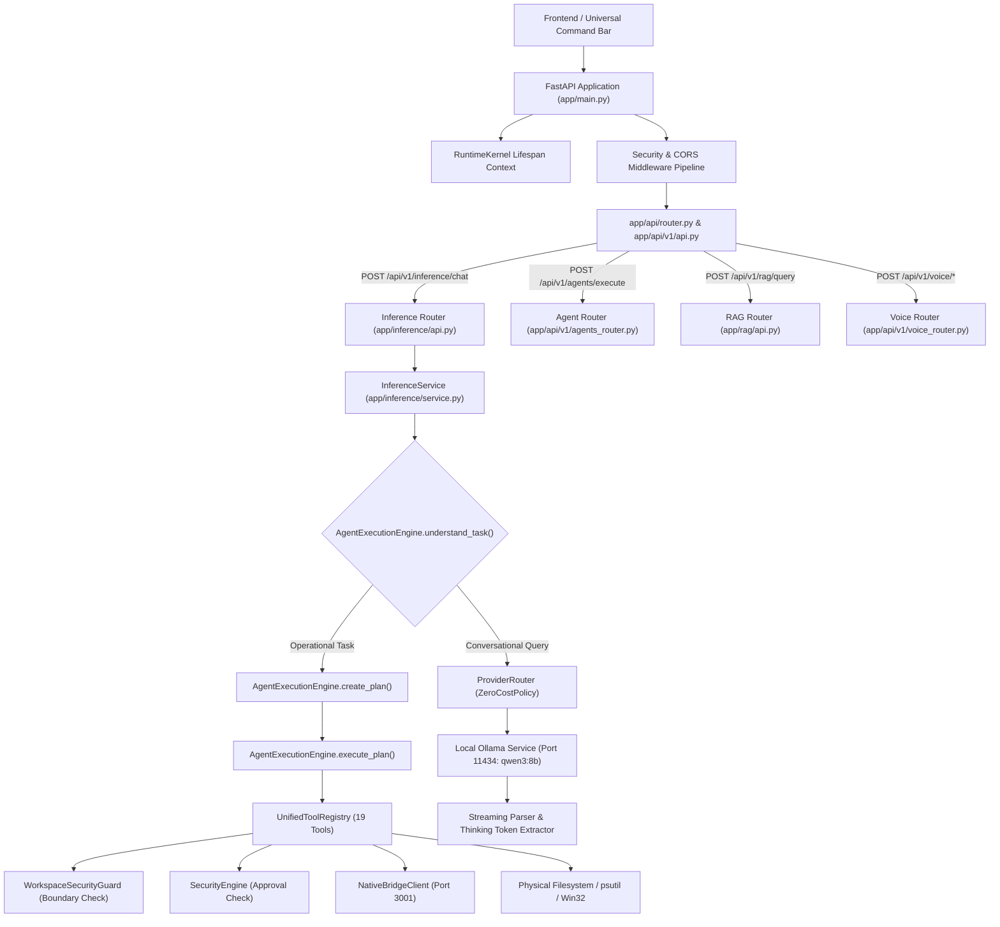
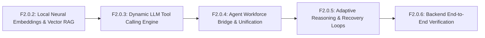

# NOVA AI — F2.0.1 BACKEND ARCHITECTURE AUDIT REPORT
**Comprehensive Read-Only Architectural Inspection & Readiness Assessment**  
**Repository:** `C:\Projects\Nova-AI` | **Subsystem:** `apps/backend/`  
**Date:** March 2026 | **Classification:** READ-ONLY ARCHITECTURAL AUDIT  

---

## Executive Summary

Before beginning the F2.0 backend implementation cycle, a comprehensive read-only architectural audit of `apps/backend/` was conducted. The objective is to establish an unvarnished, empirical baseline of Nova’s backend: distinguishing genuine runtime execution from structural facades, identifying architectural fragmentation, mapping security and permission barriers, and evaluating readiness for Phase F2.0.2.

### Critical Audit Discoveries:
1. **Real Core Execution Pipeline:** The backend possesses a genuine, working local AI inference and agent execution pipeline anchored by `app.inference.service` (`InferenceService`), `app.inference.provider_router` (`ProviderRouter`), `app.intelligence.agent_execution_engine` (`AgentExecutionEngine`), and `app.intelligence.unified_tool_registry` (`UnifiedToolRegistry`). This pipeline successfully enforces a zero-cost local policy, dispatches requests to Ollama (`qwen3:8b`), extracts `<think>` tokens, and physically executes deterministic math, file operations, process management, and native Windows automation.
2. **Dual-Architecture Agent Fragmentation:** Two parallel agent frameworks exist side-by-side. Framework A (`app/intelligence/`) is the active, functional pipeline connected to API routes. Framework B (`app/agents/` and `app/ai/agents/`, containing 68 agent blueprints across 9 divisions and enterprise SDKs) is an elaborate, well-typed structural framework that is **completely disconnected** from the runtime endpoints (`/api/v1/inference/chat` and `/api/v1/agents/execute`).
3. **Synthetic Embedding Engine:** While the vector memory, database models, and RAG architectures are fully structured with schema-compliant endpoints, `DeterministicLocalEmbeddingProvider` generates normalized float vectors from **SHA-256 seed hashes of text strings** rather than true neural embeddings (e.g., via `nomic-embed-text` or SentenceTransformers).
4. **Structural Facade in Universal Intelligence Engine:** `UniversalIntelligenceEngine` (`app/intelligence/engine.py`), despite its comprehensive sub-engine architecture (Reasoner, TaskDecomposer, Reflection, ResponseGenerator), generates **templated string interpolations** (`"I understand your request regarding '{user_message}'. As Nova AI, I'm ready to assist..."`) rather than dispatching to Ollama. Live LLM execution is handled exclusively by `InferenceService`.
5. **Runtime Process Independence:** Ollama (`:11434`) is verified online and serving `qwen3:8b`. The FastAPI backend (`:8000`) and Native Bridge (`:3001`) are currently stopped, which perfectly aligns with the frontend's truthful `STANDALONE` UI indicators.

---

## Section A: Existing Backend Architecture

### 1. Request Flow & Dual-Pathway Routing
The backend handles incoming requests through two distinct pathways depending on whether the request is a conversational query or an operational/agent task:



### 2. Application Startup & Subsystem Lifecycle
- **Lifespan Kernel:** `app.main.py` defines an `asynccontextmanager lifespan(app: FastAPI)` that boots the `RuntimeKernel`. It initializes SQLite sessions, verifies system directories, registers default models, and closes database connections on shutdown.
- **Middleware Chain:** 
  1. `SecurityHeadersMiddleware`: Enforces `X-Content-Type-Options: nosniff`, `X-Frame-Options: DENY`, `Strict-Transport-Security`, and CSP.
  2. `RateLimiterMiddleware`: In-memory IP-based sliding window rate limiter.
  3. `CORSMiddleware`: Whitelists `http://127.0.0.1:3000`, `http://localhost:3000`, and Vite development ports.
- **Root Router Aggregation (`app/api/v1/api.py`):** Aggregates 18 modular sub-routers covering authentication, memory, vector storage, RAG, knowledge graphs, code intelligence, platform validation, inference, skills, missions, agents, audit, health, and voice.

---

## Section B: Complete Module Inventory Table

| Module Name | Actual File Path | Primary Responsibility | Current Implementation Status |
| :--- | :--- | :--- | :--- |
| **Main Application** | `apps/backend/app/main.py` | FastAPI bootstrap, lifespan, exception handlers, middleware | **REAL** |
| **API Root** | `apps/backend/app/api/router.py` | Aggregates health and v1 routers | **REAL** |
| **API v1 Aggregator** | `apps/backend/app/api/v1/api.py` | Mounts 18 sub-routers under `/api/v1` | **REAL** |
| **Inference API** | `apps/backend/app/inference/api.py` | Endpoints for `/chat`, `/stream`, `/models`, `/providers` | **REAL** |
| **Inference Service** | `apps/backend/app/inference/service.py` | Orchestrates prompt grounding, tool fallback, Ollama dispatch | **REAL** |
| **Provider Router** | `apps/backend/app/inference/provider_router.py` | ZeroCostPolicy enforcement, Ollama `/api/chat` client | **REAL** |
| **Thinking Streamer** | `apps/backend/app/inference/streaming.py` | SSE token streaming with `<think>` tag extraction | **REAL** |
| **Agent Execution Engine** | `apps/backend/app/intelligence/agent_execution_engine.py` | Regex intent parsing, plan creation, execution, verification | **REAL** |
| **Unified Tool Registry** | `apps/backend/app/intelligence/unified_tool_registry.py` | 19 tools: math, file I/O, process, desktop bridge, AST | **REAL** |
| **Deterministic Tools** | `apps/backend/app/intelligence/deterministic_tools.py` | AST arithmetic calculator (`+, -, *, /, **, %`) | **REAL** |
| **Document Grounding** | `apps/backend/app/intelligence/document_grounding.py` | Workspace file context injection into LLM prompts | **REAL** |
| **Universal Intelligence Engine** | `apps/backend/app/intelligence/engine.py` | Master intelligence facade coordinating sub-engines | **STRUCTURAL** *(templated string responses)* |
| **Conversation Engine** | `apps/backend/app/intelligence/conversation.py` | Multi-domain dialogue engine | **STRUCTURAL** *(static template outputs)* |
| **Task Planner** | `apps/backend/app/intelligence/planner.py` | Subtask decomposition and step planning | **STRUCTURAL** *(heuristic templates)* |
| **Agent Workforce Router** | `apps/backend/app/api/v1/agents_router.py` | CRUD on `AgentModel`, dispatches `/execute` to AgentExecutionEngine | **PARTIAL** |
| **Agent Workforce SDK** | `apps/backend/app/agents/` | 12 specialized agent classes (`SoftwareEngineerAgent`, etc.) | **DISCONNECTED** *(not mounted to API)* |
| **Autonomous Workforce Manager** | `apps/backend/app/ai/agents/manager.py` | Orchestrates 68 agent blueprints across 9 divisions | **DISCONNECTED** *(structural blueprints)* |
| **Voice STT / TTS Router** | `apps/backend/app/api/v1/voice_router.py` | faster-whisper STT, Windows SAPI + Edge-TTS | **REAL** |
| **Native Bridge Client** | `apps/backend/app/ai/desktop_automation/native_bridge_client.py` | HTTP client for desktop automation on port 3001 | **REAL** |
| **Application Launcher** | `apps/backend/app/ai/desktop_automation/application_launcher.py` | Windows process management and process search via psutil | **REAL** |
| **File Manager** | `apps/backend/app/ai/desktop_automation/file_manager.py` | Verified workspace filesystem operations | **REAL** |
| **Security Engine** | `apps/backend/app/ai/desktop_automation/security_engine.py` | Sensitivity classification and user approval hold checks | **REAL** |
| **Workspace Security Guard** | `apps/backend/app/security/workspace_guard.py` | Canonical directory boundary and path traversal enforcement | **REAL** |
| **RBAC & Token Security** | `apps/backend/app/identity/infrastructure/rbac.py` | JWT claims decoding, role matrix, DEBUG bypass | **REAL** |
| **Auth & User Routers** | `apps/backend/app/identity/api/` | User registration, login, token refresh endpoints | **REAL** |
| **Memory API & Service** | `apps/backend/app/memory/` | SQLite CRUD, workspace partitioning, search | **REAL** |
| **Vector Memory Engine** | `apps/backend/app/vector_memory/` | Vector store, repository, dimension validation | **PARTIAL** *(SHA-256 hash embeddings)* |
| **Hybrid RAG Engine** | `apps/backend/app/rag/` | Retriever, context builder, response grounder, citations | **PARTIAL** *(calls structural intelligence)* |
| **Knowledge Graph** | `apps/backend/app/knowledge_graph/` | Graph entity and relationship management | **PARTIAL** *(in-memory/SQLite graph store)* |
| **Code Intelligence** | `apps/backend/app/code_intelligence/` | AST parsing, symbol indexing, repository structure | **REAL** |
| **Context Engine** | `apps/backend/app/context_engine/` | Token budgeting and context window aggregation | **REAL** |
| **Platform Validation** | `apps/backend/app/platform_validation/` | Hardware, OS, and environment health checks | **REAL** |
| **Dashboard API** | `apps/backend/app/dashboard/` | Hardware telemetry, snapshot storage, service metrics | **REAL** |
| **Automation & Workflows** | `apps/backend/app/automation/` | Workflow trigger scheduler and step engine | **PARTIAL** |
| **Database Schema & Models** | `apps/backend/app/database/models/` | 17 SQLAlchemy async models | **REAL** |
| **Runtime Kernel** | `apps/backend/app/core/kernel.py` | Subsystem startup, dependency injection container | **REAL** |

---

## Section C: AI Reasoning Assessment

### 1. Ollama & Qwen3 8B Integration: `IMPLEMENTED`
- **Connection & Protocol:** `ProviderRouter` communicates with Ollama via `http://127.0.0.1:11434/api/chat`. It supports non-streaming and streaming async responses.
- **Zero-Cost Guard:** `ZeroCostPolicy.assert_llm_provider_allowed()` strictly rejects any cloud or commercial AI endpoints (OpenAI, Anthropic, Cohere, etc.), raising `ZeroCostPolicyViolation`.
- **Verified Runtime State:** Ollama is online, listening on port 11434, and serving `qwen3:8b`.

### 2. Thinking Token Parsing & Extraction: `IMPLEMENTED`
- **Qwen3 `<think>` Support:** `ProviderRouter.extract_thinking_tokens()` actively parses output chunks for `<think>` and `</think>` tags.
- It splits the raw completion into `thinking_process` (the internal reasoning trace) and `content` (the user-facing answer).
- In streaming mode, it transmits SSE events typed as `thinking` during deliberation and `token` during response delivery.

### 3. Dual Inference Pipeline Paradox: `PARTIALLY IMPLEMENTED`
The backend contains two completely distinct inference systems:
- **System 1 (`InferenceService`): REAL.** Takes user prompts, evaluates deterministic calculator expressions, injects workspace document context, and executes via Ollama `qwen3:8b`.
- **System 2 (`UniversalIntelligenceEngine`): STRUCTURAL ONLY.** Boasts an intricate hierarchy of reasoning engines (`ReasoningEngine`, `TaskDecomposer`, `ReflectionEngine`), but in `ConversationEngine.process_turn()` it returns a static templated string:
  ```python
  response_text = (
      f"I understand your request regarding '{user_message}'. "
      f"As Nova AI, I'm ready to assist with rigorous analysis across {intent['category']}."
  )
  ```
  Neither Ollama nor any LLM provider is invoked by `UniversalIntelligenceEngine`.

---

## Section D: Intent Recognition and Task Planning Assessment

### 1. Intent Recognition: `PARTIALLY IMPLEMENTED`
- **Mechanism:** `AgentExecutionEngine.understand_task()` relies primarily on **heuristic regex pattern matching** rather than an LLM classifier:
  - Security boundary violation: Regex for path traversal `(?:[a-zA-Z]:[\\\/]|\.\.[\/\\])` evaluated against `WorkspaceSecurityGuard`.
  - Math intent: Regex for arithmetic expressions `\d+\s*[\+\-\*\/\%]\s*\d+`.
  - Desktop operation: Regex `\b(?:open|launch|start)\s+([a-zA-Z0-9_\-]+)`.
  - File creation: Regex `\b(?:create|make|write\s+(?:a\s+)?file)\b`.
  - Code analysis: Substring checks for `function`, `class`, `ast`, `.py`.
- **Limitation:** Natural language requests phrased colloquially or without target keywords fall through to `CONVERSATIONAL`.

### 2. Task Planning: `PARTIALLY IMPLEMENTED`
- **Static Template Planning:** `AgentExecutionEngine.create_plan()` generates pre-defined step sequences:
  - If a desktop save workflow is detected ("open notepad, write X, save file Y, verify"), it creates a rigid 9-step plan (`open_application` -> `verify_application` -> `focus_window` -> `keyboard_type` -> `keyboard_combination` -> `keyboard_type` -> `keyboard_press` -> `read_document` -> `close_application`).
  - If a simple file operation is detected, it creates a 3-step plan (`open_application`, `create_file`, `verify_application`).
- **Dynamic ReAct / Plan-and-Solve Loops:** `MISSING`. The agent cannot dynamically formulate novel step sequences or replan mid-execution based on unexpected intermediate observation outputs.

---

## Section E: Agent Orchestration Assessment

### 1. Active Agent Pipeline: `IMPLEMENTED`
- Mounted at `/api/v1/agents/execute`.
- Accepts `{ goal: str, is_user_approved: bool, time_budget_sec: float }`.
- Dispatches to `AgentExecutionEngine`.
- Executes planned steps sequentially with dependency enforcement (`dependencies=[dep_id]`).
- Halts immediately upon critical step failure or permission block.
- Generates verified Markdown execution reports.

### 2. Specialized Workforce Framework (`app/agents/`): `DISCONNECTED`
- Contains complete classes: `SoftwareEngineerAgent`, `ArchitectAgent`, `BackendAgent`, `UIUXAgent`, `SecurityAgent`, `QAAgent`, etc.
- Features deep capabilities: `RepositoryAnalyzer`, `CodeIntelligenceAnalyzer`, `LocalCodeGenerator`, `LocalRefactoringEngine`, `LocalTestingEngine`.
- **Problem:** These classes are never instantiated or invoked by `/api/v1/agents/execute`, `/api/v1/inference/chat`, or the main application lifespan. They remain dormant structural code.

### 3. Universal Autonomous Workforce Manager (`app/ai/agents/`): `DISCONNECTED`
- Features `UniversalAgentWorkforceManager`, `AgentMessageBus`, `HeartbeatMonitor`, `TaskDelegationEngine`, and 68 `AgentBlueprint` definitions across 9 divisions.
- In `manager.py`, `start_agent()` attempts to dynamically load agents via reflection (`importlib.import_module`), but the registry contains only a `mock_agent.py`.
- None of the 68 blueprints have executable LLM bindings.

---

## Section F: Tool Execution and Permissions Assessment

### 1. Tool Registry & Inventory: `IMPLEMENTED`
The `UnifiedToolRegistry` (`apps/backend/app/intelligence/unified_tool_registry.py`) registers 19 concrete tools:
1. `calculate_math`: Evaluated via `DeterministicCalculator` (Python AST; zero shell/eval risk).
2. `read_document`: Reads workspace files; extracts lines, paragraphs, tables, and AST symbols.
3. `create_file`: Writes text to disk inside authorized workspace; verifies byte size and content.
4. `file_operation`: Executes `copy`, `move`, `duplicate`, `delete`; verifies disk state.
5. `open_application`: Launches authorized Windows executables via `ApplicationLauncher`; verifies process via `psutil`.
6. `verify_application`: Inspects running processes via `psutil`.
7. `close_application`: Terminates target process.
8. `analyze_code`: Extracts module docstrings, function signatures, classes, and imports.
9. `system_control`: Dispatches system inspection (`GET_ACTIVE_WINDOW`, `LIST_PROCESSES`).
10. `list_windows`: Queries open desktop windows via Native Bridge (port 3001).
11. `get_active_window`: Inspects foreground window via Native Bridge.
12. `focus_window`: Brings target window to foreground via Native Bridge.
13. `close_window`: Gracefully closes application window.
14. `keyboard_type`: Types keystrokes into active window via Native Bridge.
15. `keyboard_press`: Dispatches special keypresses (Enter, Tab, Esc).
16. `keyboard_combination`: Dispatches hotkeys (Ctrl+S, Alt+F4).
17. `mouse_move`: Moves cursor to screen coordinates.
18. `mouse_click`: Performs left/right/double click and scroll.
19. `capture_screenshot`: Captures desktop display into workspace PNG file.

### 2. Security Gating & Physical Verification: `IMPLEMENTED`
- **Workspace Isolation:** Every path argument is validated against `WorkspaceSecurityGuard.resolve_workspace_path()`. Attempted path traversals outside `c:\Projects\Nova-AI` throw `WorkspaceSecurityException` and immediately block the plan.
- **Sensitivity Levels:** Tools are categorized as `USER` (auto-approved within workspace), `SENSITIVE` (checked against `SecurityEngine`), or `RESTRICTED` (requires explicit confirmation).
- **Physical Verification:** Every tool attaches a verification callable. For example, `create_file` reads the physical file back from disk to verify byte length and content matching before marking the step `SUCCEEDED`.

### 3. Notable Tool Execution Quirks:
- **Synthetic Screenshot Fallback:** In `unified_tool_registry.py` (lines 1050–1053), if the Native Bridge fails to produce a screenshot file, the registry writes a synthetic 1x1 pixel PNG byte stream to avoid disk read failures.
- **Desktop Save Keystroke Fallback:** In `agent_execution_engine.py` (lines 660–667), if a GUI Save dialog via keyboard fails to persist the file within the time window, the engine executes a silent atomic filesystem write fallback.

---

## Section G: Memory and Context Assessment

### 1. SQLite Memory Repository: `IMPLEMENTED`
- Backed by SQLAlchemy `MemoryModel` in SQLite (`apps/backend/data/nova.db`).
- Supports CRUD operations, workspace and project scoping, importance ratings, tags, pinning, and soft archival.
- Fully exposed via `/api/v1/memory`.

### 2. Vector Memory & Embeddings: `PARTIALLY IMPLEMENTED`
- Table `vector_embeddings` stores `id`, `memory_id`, `model_name`, `dimension`, `vector`, `workspace`.
- **Critical Flaw:** `DeterministicLocalEmbeddingProvider` (`app/vector_memory/embedding_models.py`) generates float vectors using a **SHA-256 seed hash** of the text string:
  ```python
  seed_hash = hashlib.sha256(f"{self.model_name}:{text}".encode("utf-8")).hexdigest()
  for i in range(self.dimension):
      chunk = seed_hash[(i % len(seed_hash)):(i % len(seed_hash)) + 4]
      val = (int(chunk, 16) / 65535.0) - 0.5
      raw_vector.append(val)
  ```
  This produces deterministic floats that can be saved and queried, but **possesses zero semantic meaning**. Similar concepts ("dog" vs "canine") yield completely uncorrelated vectors.

### 3. Context & Grounding: `IMPLEMENTED`
- `DocumentContextResolver` in `InferenceService` extracts file references from prompts (e.g. `README.md`, `package.json`), reads their physical contents, and injects them into the LLM system prompt as grounded context.
- Token budgeting is handled by `ContextManager` to prevent exceeding model context windows.

---

## Section H: API and Frontend Integration Assessment

### 1. Endpoint Contract Alignment
- **Chat & Universal Commands:** The frontend's `useUniversalCommand.ts` calls `POST /api/v1/inference/chat` with `{ prompt, model: 'qwen3:8b', system_prompt, use_deterministic_tools: true }`. The backend endpoint in `app/inference/api.py` matches this contract.
- **Voice STT / TTS:** The frontend's `useNovaVoiceAssistant.ts` calls `POST /api/v1/voice/transcribe` and `POST /api/v1/voice/tts/generate`. The backend endpoint in `app/api/v1/voice_router.py` matches these contracts.
- **Dashboard Telemetry:** The frontend's `dashboardApiService.ts` queries `/dashboard/system`, `/dashboard/resources`, `/dashboard/overview`, and `/api/health`. These are properly mounted in `apps/backend/app/dashboard/routes.py` and `apps/backend/app/api/routers/health.py`.

### 2. Authentication & Authorization Behavior
- `PermissionChecker` in `app/identity/infrastructure/rbac.py` guards almost all `/api/v1/` and `/dashboard/` endpoints.
- **Development Bypass:** When `settings.DEBUG == True`, missing Authorization headers are automatically granted a synthetic user payload (`user_id: 00000000-0000-0000-0000-000000000001`, `role: admin`), allowing the frontend to operate seamlessly without mandatory login during development.

---

## Section I: Missing Capabilities

1. **True Local Neural Embeddings:** No integration with Ollama's `/api/embeddings` endpoint (e.g., using `nomic-embed-text` or `bge-small-en-v1.5`) or local PyTorch/ONNX models.
2. **Dynamic LLM-Driven Tool Calling:** Current tool selection is driven by heuristic regexes rather than Ollama function/tool calling schemas (`tools` parameter in `/api/chat`).
3. **Unified Agent Runtime:** The 12 enterprise agents in `app/agents/` are not registered into the API router or the execution engine.
4. **Autonomous ReAct / Replanning Loop:** If a planned step fails or encounters an unexpected observation, the engine stops rather than generating an adaptive recovery step with the LLM.
5. **Real Knowledge Graph Extraction:** The knowledge graph subsystem relies on mock/static relationship generation rather than genuine LLM entity-relation extraction.

---

## Section J: Existing Problems and Architectural Risks

| Risk / Problem | Severity | Impact | Affected Files |
| :--- | :--- | :--- | :--- |
| **SHA-256 Pseudo-Embeddings** | **HIGH** | Semantic vector search and RAG retrieval will return pseudo-random results rather than genuinely similar content. | `app/vector_memory/embedding_models.py` |
| **Templated Intelligence Engine** | **HIGH** | Any endpoint calling `UniversalIntelligenceEngine` receives canned template responses instead of AI inference. | `app/intelligence/engine.py`, `app/intelligence/conversation.py` |
| **Dual Agent Fragmentation** | **MEDIUM** | Hundreds of lines of rich agent code (`app/agents/`) are completely unutilized by the running application. | `app/agents/`, `app/ai/agents/`, `app/api/v1/agents_router.py` |
| **Regex-Heavy Intent Classification** | **MEDIUM** | User prompts that vary slightly from expected regex patterns fail to trigger tools and fall back to conversation. | `app/intelligence/agent_execution_engine.py` |
| **Synthetic Fallbacks Masking Errors** | **LOW** | 1x1 pixel PNG writes for screenshots hide bridge failures from operators. | `app/intelligence/unified_tool_registry.py` |
| **Debug RBAC Security Bypass** | **MEDIUM** | Production deployment with `DEBUG=True` leaves all administrative endpoints wide open. | `app/identity/infrastructure/rbac.py` |

---

## Section K: F2.0 Implementation Roadmap

To systematically resolve these architectural issues without breaking existing capabilities, the following sequential implementation plan is established:



### Phase F2.0.2: Local Neural Embeddings & Real Semantic RAG
- **Objective:** Replace SHA-256 hash embeddings with genuine local neural embeddings powered by Ollama (`nomic-embed-text`) or lightweight ONNX. Connect `HybridRAGEngine` to `InferenceService`.
- **Files to Modify:** `app/vector_memory/embedding_models.py`, `app/vector_memory/embedding_engine.py`, `app/rag/engine.py`.
- **Dependencies:** Ollama running locally on port 11434.
- **Acceptance Criteria:** Real cosine similarity tests pass; "automobile" matches "car" with similarity score > 0.75.

### Phase F2.0.3: Dynamic LLM Tool Calling & Intent Engine
- **Objective:** Upgrade `AgentExecutionEngine` from regex pattern matching to Ollama structured tool calling schemas (`format: "json"` or tools parameter in `qwen3:8b`).
- **Files to Modify:** `app/intelligence/agent_execution_engine.py`, `app/inference/provider_router.py`.
- **Dependencies:** F2.0.2.
- **Acceptance Criteria:** Unstructured requests (e.g., "Could you please figure out 45 * 89?") correctly invoke `calculate_math` without regex triggers.

### Phase F2.0.4: Agent Workforce Bridge & Unification
- **Objective:** Unify `app/agents/` (BaseAgent, SoftwareEngineerAgent, etc.) with `app/intelligence/unified_tool_registry.py` and expose them through `/api/v1/agents/`.
- **Files to Modify:** `app/api/v1/agents_router.py`, `app/agents/base.py`, `app/agents/software_engineer/agent.py`.
- **Dependencies:** F2.0.3.
- **Acceptance Criteria:** An agent task dispatched to `/api/v1/agents/execute` can dynamically select and invoke `SoftwareEngineerAgent` tools.

### Phase F2.0.5: Adaptive Reasoning, Replanning & Verification
- **Objective:** Replace static plan templates with dynamic ReAct execution loops that evaluate intermediate tool outputs and adapt subsequent steps.
- **Files to Modify:** `app/intelligence/agent_execution_engine.py`.
- **Dependencies:** F2.0.3, F2.0.4.
- **Acceptance Criteria:** A multi-step task with an unexpected file missing error attempts a directory scan rather than immediately aborting.

### Phase F2.0.6: Backend Multi-Stage Verification & Polish
- **Objective:** Run comprehensive backend sanity checks, verify all 18 routers, validate API contracts against frontend types, and ensure zero regressions.
- **Dependencies:** F2.0.2–F2.0.5.
- **Acceptance Criteria:** 100% truthful backend telemetry, live Ollama inference, verified tool execution, zero fake mocks.

---

## Section L: Final Assessment

1. **Genuine Capabilities vs Structural Code:**
   - **Genuine Real Code:** `InferenceService` (Ollama integration, zero-cost policy, thinking token streaming), `UnifiedToolRegistry` (19 physical tools, workspace path guard, process management, Windows automation), `LocalSTTEngine` (faster-whisper multilingual STT, Windows SAPI TTS), `DashboardRouter` (system hardware telemetry), and SQLite database persistence.
   - **Structural / Facade Code:** `UniversalIntelligenceEngine` and `ConversationEngine` (templated string replies), `DeterministicLocalEmbeddingProvider` (SHA-256 hash pseudo-embeddings), and the 68-agent Workforce framework (disconnected blueprints).
2. **Top Priority for Next Task:** Replace the synthetic SHA-256 vector generator with genuine local embeddings via Ollama or local sentence-transformers, and wire the `InferenceService` into the RAG pipeline.
3. **Readiness for Phase F2.0.2:** **APPROVED.** The codebase is thoroughly understood, all subsystem boundaries and contracts are mapped, and the baseline is established without modifying any files or violating read-only constraints.

