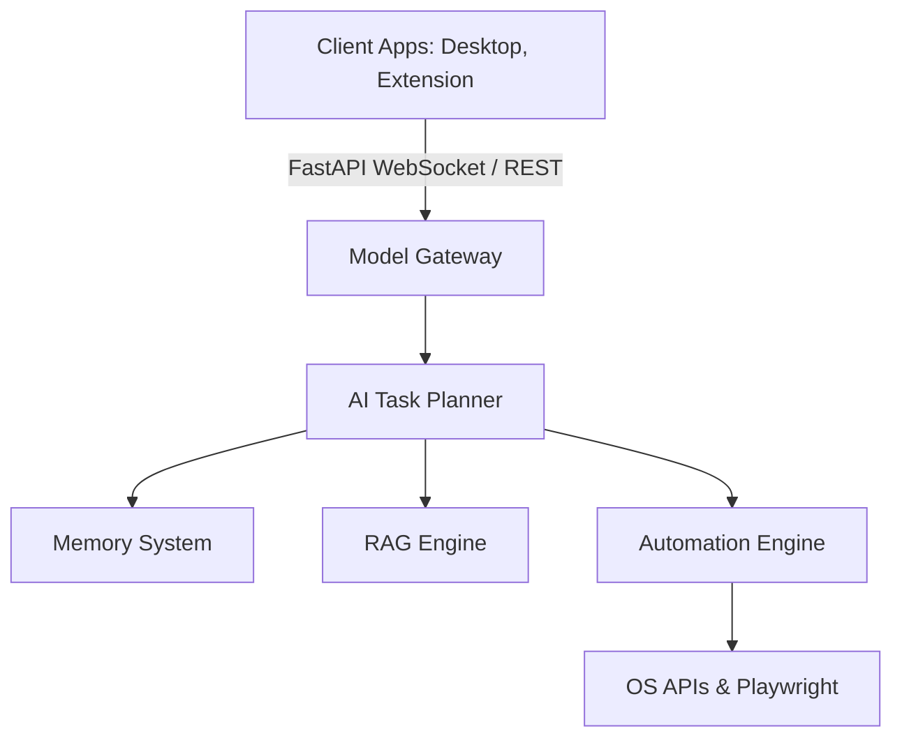

# Nova AI - The Universal AI Operating Layer

Nova AI is an enterprise-grade, application-agnostic operating layer designed to control and understand software environments via natural language, voice commands, screen vision, and automated workflow orchestrations.

---

## 1. Project Architecture

Nova AI is built around a modular, clean architectural pattern separating presentation layer interfaces, business services, and infrastructural adapters.



### Key Subsystems:
- **FastAPI Backend Services**: Drives core routing, database pools, logging spans, and exceptions processing.
- **AI Task Planner**: Coordinates dynamic task decomposition and safety policy evaluations.
- **Memory & RAG Services**: Manage long-term session contexts, user preferences, and local document parsing caches.
- **Automation Engine**: Executes low-level keyboard/mouse operations and browser steps via Playwright.

---

## 2. Requirements

Ensure the following tools are installed on your local development environment:
- **Node.js**: `v22.0.0` or higher
- **pnpm**: `v11.0.0` or higher (Monorepo project package manager)
- **Python**: `v3.12` or higher (Targeting `v3.14`)
- **Docker & Compose**: (Required for local Postgres, Redis, and Qdrant database clusters)

---

## 3. Project Structure

```
Nova-AI/
├── apps/
│   ├── backend/         # Python/FastAPI API Service
│   ├── desktop/         # Electron desktop user interface
│   └── browser-ext/     # Chrome/Edge extension scripts
├── packages/
│   ├── shared/          # Shared type wrappers and resources
│   └── ui/              # Component library utilities
├── docs/                # System architectures and guidelines
├── pnpm-workspace.yaml  # Node monorepo packages listing
├── pyproject.toml       # Workspace settings index
└── README.md            # Main project document
```

---

## 4. Installation & Quick Start

### Step 1: Clone the repository
```bash
git clone https://github.com/yokraj/nova-ai.git
cd nova-ai
```

### Step 2: Install dependencies
Installs TypeScript workspaces and builds project links:
```bash
pnpm install
```

### Step 3: Set up Python backend workspace
Configure your local environment and sync virtual packages:
```bash
cd apps/backend
cp .env.example .env
# Create virtual environment and install packages
python -m venv .venv
# On Windows:
.venv\Scripts\activate
# Install requirements
pip install -e .
```

### Step 4: Run the development servers
Start the FastAPI server:
```bash
uvicorn app.main:app --reload --port 8000
```
FastAPI interactive docs will automatically become available at: `http://localhost:8000/docs`

---

## 5. Development Workflow

- Code style is strictly managed by **Black** (formatting) and **Ruff** (linting).
- All functions must contain **Google-style docstrings** and detailed **type hints**.
- Run syntax validations before submitting PRs:
  ```bash
  python -m py_compile apps/backend/app/**/*.py
  ```

---

## 6. Project Roadmap

- **Phase 1**: Core Backend Foundation (FastAPI, structured logging, error handling, session pooling) - *Completed*
- **Phase 2**: Backend Database Entities, Migrations, and JWT Auths.
- **Phase 3**: Desktop UI Shell, Voice command routing, and STT pipelines.
- **Phase 4**: RAG document ingestion, Qdrant search indices, and Vision screen recognition adapters.
- **Phase 5**: Multi-agent orchestration and low-level browser automation engine.

---

## 7. Contributing

We welcome community contributions. Please review our [Engineering Guidelines](file:///C:/Projects/Nova-AI/docs/ENGINEERING_GUIDELINES.md) to understand project standards, git naming conventions, and review cycles before opening pull requests.
