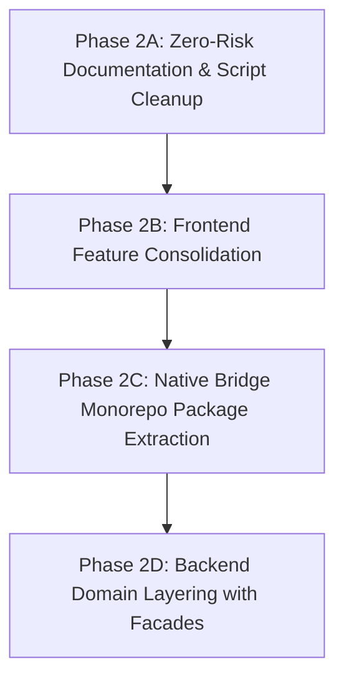

# NOVA AI — PROFESSIONAL REPOSITORY ORGANIZATION PLAN (STAGE 1: AUDIT & ARCHITECTURE PLAN)

**Document Version:** 1.0.0  
**Audit Date:** November 4, 2026  
**Repository:** `C:\Projects\Nova-AI`  
**Execution Stage:** Stage 1 — Audit and Architecture Planning Only (Strict Read-Only)  
**Author:** AI Architecture Engineering Pair  

---

## 1. EXECUTIVE SUMMARY & OBJECTIVES

Nova AI is an enterprise-grade AI operating layer featuring local-first AI intelligence (Ollama), real Windows OS computer automation, speech recognition and synthesis (Windows SAPI prosody + Microsoft Edge TTS), multi-agent workforce orchestration, and an interactive React 19 holographic command interface.

Following the initial Phase 2 cleanup (which removed 201 redundant test duplicates, scratch files, and generated FAISS caches), the repository contains **2,856 project-owned files** across **652 directories**.

### Primary Objectives of Stage 1
1. **Analyze Current State:** Map all applications, services, scripts, models, data stores, and documentation.
2. **Evaluate Structural Deficiencies:** Diagnose organizational debt, architectural overlaps, naming inconsistencies, and boundary ambiguities.
3. **Design Target Monorepo Architecture:** Propose a professional, modular structure adhering to modern monorepo standards.
4. **Impact & Risk Assessment:** Classify every proposed organizational change into `SAFE`, `CAUTION`, or `HIGH RISK`, with explicit dependency mapping.
5. **Formulate a Non-Disruptive Phased Implementation Plan:** Ensure zero downtime, zero broken imports, and zero API contract regressions for Stage 2 execution.

---

## 2. CURRENT REPOSITORY ARCHITECTURE & DIRECTORY INVENTORY

### Current High-Level Tree
```text
C:\Projects\Nova-AI
├── .agents/                    # Antigravity developer plugin rules and skills (18 files)
├── .nova/                      # Active semantic capabilities catalog & memory (6 files)
├── .vscode/                    # VS Code workspace settings (1 file)
├── apps/
│   ├── backend/                # FastAPI backend service & cognitive AI (2,308 files)
│   └── frontend/               # React 19 + Vite frontend & Native Bridge (479 files)
├── data/                       # Active SQLite database (data/nova_ai.db, 1.3 MB) (1 file)
├── docs/                       # Architecture, guides, reports, and archive/ (21 files)
├── node_modules/               # Monorepo pnpm dependencies (190.8 MB)
├── packages/                   # Empty monorepo package directories (config, sdk, shared, ui) (0 files)
├── scripts/                    # Root TypeScript testing runners (8 files)
├── .editorconfig               # 0-byte editor config placeholder
├── .env.example                # 0-byte environment template placeholder
├── .gitattributes              # Git line endings & attributes configuration
├── .gitignore                  # Git ignore rules
├── CHANGELOG.md                # 0-byte changelog placeholder
├── CODE_OF_CONDUCT.md          # 0-byte code of conduct placeholder
├── CONTRIBUTING.md             # 0-byte contribution guidelines placeholder
├── LICENSE                     # 0-byte license placeholder
├── package.json                # Monorepo root package manifest (pnpm 11.10.0)
├── pnpm-lock.yaml              # Monorepo pinned lockfile
├── pnpm-workspace.yaml         # Defines packages: ["apps/*", "packages/*"]
├── README.md                   # Main project README
├── REPOSITORY_CLEANUP_AUDIT_REPORT.md  # Historical Phase 1 audit and Phase 2 cleanup record
└── ZERO_COST_DEVELOPMENT_POLICY.md     # Project Zero-Cost AI Policy
```

### Module File Counts
| Module | Location | File Count | Primary Role |
|---|---|---|---|
| **Backend Core** | `apps/backend/app/` | **2,141** | FastAPI entrypoint, AI cognitive kernel, agent divisions, memory, voice |
| **Backend Tests** | `apps/backend/tests/` | **142** | Automated unit & integration tests, Blender LTS tests, live benchmarks |
| **Backend Migrations** | `apps/backend/alembic/` | **7** | Alembic migration environment and 4 migration version scripts |
| **Backend Root** | `apps/backend/` | **18** | `pyproject.toml`, `uv.lock`, `alembic.ini`, 3 standalone verify scripts |
| **Frontend Source** | `apps/frontend/src/` | **448** | React 19 UI, Dashboard widgets, Holographic Core, Native Bridge |
| **Frontend Scripts** | `apps/frontend/scripts/` | **25** | `startNativeBridge.ts` launcher and 24 TypeScript test runners |
| **Frontend Root** | `apps/frontend/` | **6** | `package.json`, `vite.config.ts`, `tsconfig*.json`, `eslint.config.js` |
| **Documentation** | `docs/` | **21** | System architecture, security, guides, release notes, archive |
| **Developer Skills** | `.agents/` | **18** | Antigravity developer plugin skills, rules, and hook definitions |
| **Standalone Scripts** | `scripts/testing/` | **8** | Standalone TypeScript test harnesses reaching into frontend |
| **Runtime Data & Indexes**| `data/`, `.nova/` | **7** | `nova_ai.db` (1.3 MB), semantic capability metadata & FAISS index |
| **Root Configurations**| Root `.` | **15** | Manifests, policies, git configs, 0-byte documentation placeholders |
| **TOTAL** | | **2,856** | Excludes dependencies, virtual environments, and caches |

---

## 3. ARCHITECTURAL PROBLEMS & EVALUATION FINDINGS

Evaluating the repository against modern architectural standards reveals 14 key structural challenges:

### 1. Files Stored in Inappropriate Directories
- **Backend Root Scripts:** `apps/backend/verify_autonomous_engine.py`, `verify_deployment.py`, and `verify_project_manager.py` reside at the root of `apps/backend/` alongside configuration manifests instead of in a designated `scripts/` directory.
- **Native Bridge Server in Frontend Source:** The native Windows automation server (`nativeBridgeServer.ts`, `windowsNativeHelper.ts`, `executableRegistry.ts`) is located at `apps/frontend/src/features/native-bridge/server/`. This places privileged Win32 Node.js server code inside a client-side React browser application folder.
- **Root Standalone Test Runners:** `scripts/testing/` holds 8 standalone TypeScript test scripts (`runAdvancedAIBrainTests.ts`, `runUniversalWindowsAgentTests.ts`, etc.) that reach into `../../apps/frontend/src/...`. They belong logically inside `apps/frontend/scripts/` or `packages/native-bridge/scripts/`.

### 2. Duplicate or Overlapping Directories
- **Analytics Overlap:** `apps/backend/app/analytics` (5 unimplemented stub files raising `NotImplementedError`) exists alongside `apps/backend/app/analytics_engine` (13 fully implemented production modules).
- **Notifications Overlap:** `apps/backend/app/notifications` (4 unimplemented stub files) exists alongside `apps/backend/app/notification_engine` (13 fully implemented production modules).
- **Automation Fragmentation:** Automation is split across `apps/backend/app/automation` (7 workflow files), `apps/backend/app/ai/automation` (56 files), and `apps/backend/app/ai/desktop_automation` (101 files).
- **Vision Fragmentation:** Vision logic is split across `apps/backend/app/vision` (1 stub file), `apps/backend/app/ai/vision` (32 files), and `apps/backend/app/ai/computer_vision` (24 files).
- **Voice Fragmentation:** Speech logic is split between `apps/backend/app/voice` (1 stub file) and `apps/backend/app/ai/voice` (31 files).
- **Memory Subsystems:** Memory logic is divided between `apps/backend/app/memory` (23 files), `apps/backend/app/ai/memory` (30 files), `apps/backend/app/vector_memory` (21 files), and `apps/backend/app/rag` (22 files).
- **Agent Subsystems:** Agents are divided between `apps/backend/app/agents` (341 enterprise role files) and `apps/backend/app/ai/agents` (48 autonomous framework files).
- **Dual Runtime Directories:** Both root `.nova/` and `apps/backend/.nova/` exist, as well as root `data/` and `apps/backend/data/`.

### 3. Inconsistent Naming Conventions
- **Frontend Features:** Kebab-case (`device-control`, `native-bridge`, `nova-core`, `universal-command`, `ai-runtime`, `background-runtime`, `file-system`, `execution-runtime`, `workflow-studio`) is mixed with single-word naming (`agents`, `browser`, `conversation`, `dashboard`, `knowledge`, `memory`, `missions`, `skills`, `swarm`, `vision`, `voice`).
- **Backend Modules:** Single-word names (`automation`, `conversation`, `identity`, `inference`, `intelligence`, `memory`, `orchestrator`, `runtime`, `security`) are mixed with compound underscore names (`code_intelligence`, `context_engine`, `knowledge_graph`, `live_metrics`, `notification_engine`, `platform_validation`, `vector_memory`, `analytics_engine`).
- **Backend Tests:** Test files mix standard `test_*` prefixes with `verify_*` (`verify_f1_6_1_live_connectivity.py`, `verify_priority_*.py`) and `benchmark_*` (`benchmark_phase_11.py`).

### 4. Backend Modules Not Organized by Architectural Layer
- `apps/backend/app/` has a flat namespace containing **38 top-level directories**. Low-level infrastructure (`core`, `database`, `api`, `websocket`), domain services (`identity`, `conversation`, `dashboard`), cognitive intelligence engines (`inference`, `intelligence`, `ai/`), memory subsystems (`memory`, `vector_memory`, `rag`, `knowledge_graph`), and agent divisions (`agents/`, `agent_sdk/`) all sit side-by-side at the same directory depth without layering.

### 5. Frontend Modules That Do Not Follow a Unified Feature Architecture
- In `apps/frontend/src/`, `App.tsx` sits inside `src/app/App.tsx` while `routes/` is outside `app/`, `layouts/` is outside `components/`, and `tokens/` is in `src/tokens/`.
- `components/dashboard/` holds 10 dashboard widgets that belong logically within `features/dashboard/components/`.

### 6. Native Bridge Files Needing Clearer Boundaries
- The Native Bridge is both an OS-level daemon service (started via Node.js script `startNativeBridge.ts`) and a web frontend client (`nativeBridgeClient.ts`). Placing both in `apps/frontend/src/features/native-bridge/` creates confusion regarding what runs in browser sandboxes versus Node.js OS environments.

### 7. Scripts Mixed with Production Code
- `verify_autonomous_engine.py`, `verify_deployment.py`, and `verify_project_manager.py` sit directly in `apps/backend/`.
- `apps/backend/tests/` contains non-pytest benchmark and verification scripts.

### 8. Documentation Scattered Across Locations
- Root holds `ZERO_COST_DEVELOPMENT_POLICY.md` and `README.md`.
- `docs/` has top-level markdown files (`DEVELOPER_GUIDE.md`, `ENGINEERING_GUIDELINES.md`) alongside subdirectories (`architecture/`, `database/`, `deployment/`, `operations/`, `release/`, `reports/`, `security/`, `testing/`, `archive/`).
- `apps/backend/` has its own `README.md`.

### 9. Configuration Files in Inappropriate Locations
- 6 zero-byte placeholder files sit in root (`.editorconfig`, `.env.example`, `CHANGELOG.md`, `CODE_OF_CONDUCT.md`, `CONTRIBUTING.md`, `LICENSE`).
- Backend has its own `.env` and `.env.example`, while root `.env.example` is 0 bytes.

### 10. Runtime Data Mixed with Source Structure
- `data/nova_ai.db` (1.3 MB SQLite database) is stored in the repository root directory `data/`.
- `.nova/capabilities/` stores 9.4 MB of binary FAISS index and JSON metadata files.
- `apps/backend/data/nova_ai.db` is an empty 0-byte file resulting from relative path execution.

### 11. AI Models, Indexes, and Caches Needing Separation
- `.nova/` contains both durable indexes (`capabilities/faiss_index.json`, `memory/graph_index.json`) and transient voice audio caches (`.nova/cache/voice/synthesized_response.wav`).

### 12. Unclear Module Boundaries Between Intelligence & Inference
- `apps/backend/app/inference/` manages model endpoints, Ollama provider dispatch, and zero-cost policy enforcement.
- `apps/backend/app/intelligence/` manages cognitive planning, reasoning, reflection, and unified tool registry.
- Clearer interface contracts between the cognitive reasoning layer and the inference transport layer are needed.

### 13. Empty Directory Skeletons
- `packages/` currently has 4 empty folders (`config/`, `sdk/`, `shared/`, `ui/`) that have not been initialized as published workspace packages.

### 14. Import and Path Dependencies Affected by Movements
- In `apps/backend/app/`, 2,141 Python files use absolute imports with the package root `app.` (e.g. `from app.identity... import ...`, `from app.core... import ...`). Moving directories inside `app/` without backwards-compatible re-exports would cause widespread `ImportError` failures.
- In `apps/frontend/`, the path alias `@/*` maps to `src/*`. Moving frontend files requires updating import specifiers.

---

## 4. TARGET ARCHITECTURE SPECIFICATION

To resolve these deficiencies while ensuring 100% backwards compatibility and stability, the target architecture establishes clean, industry-standard monorepo boundaries.

### A. Repository Root Architecture

```text
C:\Projects\Nova-AI
├── .agents/                    # Antigravity developer plugin rules and skills
├── .nova/                      # Local AI assets, semantic capabilities, and FAISS indexes
├── .vscode/                    # Workspace IDE settings
├── apps/
│   ├── backend/                # FastAPI backend service (Python 3.12+)
│   └── frontend/               # React 19 + Vite web frontend
├── data/                       # Local SQLite databases and persistent application state
├── docs/                       # Centralized engineering documentation
├── packages/                   # Monorepo shared packages
│   ├── config/                 # Shared TypeScript, ESLint, Prettier, Tailwind configs
│   ├── native-bridge/          # Standalone Node.js Win32 automation bridge
│   ├── shared/                 # Shared TypeScript/Python schemas, types, and IPC contracts
│   └── ui/                     # Shared UI components and design system tokens
├── scripts/                    # Monorepo-level automation, verification, and tooling
│   ├── testing/                # Multi-service end-to-end test runners
│   └── setup/                  # Environment bootstrapping and health check scripts
├── .editorconfig               # Populated editor configuration
├── .env.example                # Centralized environment variable template
├── .gitattributes              # Git attributes and line-ending rules
├── .gitignore                  # Git ignore rules
├── CHANGELOG.md                # Project release changelog
├── LICENSE                     # MIT License specification
├── package.json                # Monorepo workspace root manifest
├── pnpm-lock.yaml              # Authoritative pnpm lockfile
├── pnpm-workspace.yaml         # Monorepo workspace configuration
├── README.md                   # Project overview, quickstart, and architecture map
├── REPOSITORY_ORGANIZATION_PLAN.md # This architectural plan
└── ZERO_COST_DEVELOPMENT_POLICY.md # Non-negotiable zero-cost policy governance
```

---

### B. Backend Target Architecture (`apps/backend/`)

To structure the 38 top-level modules in `apps/backend/app/` without breaking any of the 2,141 existing `from app.<module>...` imports, we introduce **Layered Architectural Namespaces** with **Backwards-Compatible Facade Re-exports**.

```text
apps/backend/
├── alembic/                    # Database migrations
│   ├── versions/               # 0001 through 0004 migration scripts
│   └── env.py
├── app/
│   ├── api/                    # REST Routing Layer
│   │   ├── routers/            # System & health routers
│   │   ├── v1/                 # Version 1 API routers (auth, voice, agents, missions)
│   │   └── router.py           # Central router registry
│   ├── core/                   # Core Infrastructure & Cross-Cutting Concerns
│   │   ├── config.py           # Application settings & environment variables
│   │   ├── constants.py        # System constants & versioning
│   │   ├── dependency_container.py # DI container & provider bindings
│   │   ├── exceptions.py       # Custom exception hierarchies
│   │   ├── logging.py          # Structured logging configuration
│   │   ├── middleware.py       # CORS, gzip, security middleware
│   │   └── zero_cost_policy.py # Zero-Cost policy enforcement guard
│   ├── database/               # Database Access & ORM Models
│   │   ├── base.py             # SQLAlchemy declarative base
│   │   ├── models/             # Centralized SQLAlchemy entity models
│   │   ├── session.py          # Async session engine
│   │   └── unit_of_work.py     # Unit of Work pattern implementation
│   ├── domain/                 # Core Business Domain Services
│   │   ├── identity/           # Authentication, Users, Tokens, RBAC
│   │   ├── conversation/       # Chat sessions, messages, attachments
│   │   └── dashboard/          # Analytics aggregations, notifications, metrics
│   ├── intelligence/           # Cognitive Kernel & AI Orchestration
│   │   ├── inference/          # Ollama client, provider router, model registry, fallbacks
│   │   ├── cognitive/          # Decision engine, reasoner, reflection, planner
│   │   ├── memory/             # Hybrid RAG, vector memory, knowledge graph, context engine
│   │   └── tools/              # Unified tool registry, tool router, execution engine
│   ├── ai/                     # Autonomous Subsystems & Actuators
│   │   ├── voice/              # Windows SAPI female prosody, Edge TTS neural, Whisper STT
│   │   ├── desktop_automation/ # Win32 window manipulation, process lifecycle, input injection
│   │   ├── vision/             # Screen capture, OCR grounding, computer vision
│   │   ├── research/           # Literature discovery, evidence graph builder, citations
│   │   └── agents/             # Autonomous agent workforce, divisions, state machine
│   ├── websocket/              # Real-time WebSocket connection manager & router
│   └── main.py                 # FastAPI application boot entrypoint
├── scripts/                    # Backend maintenance & verification scripts
│   ├── verify_autonomous_engine.py
│   ├── verify_deployment.py
│   └── verify_project_manager.py
├── tests/                      # Pytest automated test suite (142 files)
│   ├── conftest.py
│   ├── unit/                   # Fast isolated unit tests
│   ├── integration/            # Multi-module integration tests
│   └── blender/                # Blender 5.2 LTS BMesh action tests
├── alembic.ini
├── pyproject.toml
└── uv.lock
```

#### Backwards-Compatibility Strategy for Backend
To allow modules like `app.identity`, `app.conversation`, `app.inference`, `app.memory`, etc. to transition cleanly into layered subfolders (`app/domain/identity`, `app/intelligence/inference`, etc.):
1. Every legacy module folder in `app/` retains its `__init__.py` file containing facade re-exports:
   ```python
   # apps/backend/app/identity/__init__.py
   # Facade re-exporting from domain layer for 100% backwards compatibility
   from app.domain.identity import *
   ```
2. Existing internal files continue functioning without requiring all 2,141 files to be edited simultaneously.
3. New code imports from the clean domain namespaces.

---

### C. Frontend Target Architecture (`apps/frontend/`)

```text
apps/frontend/
├── src/
│   ├── app/                    # Application Root & Bootstrapping
│   │   ├── config/             # App configuration (app.config.ts)
│   │   ├── providers/          # React Query, Router, Theme providers
│   │   ├── routes/             # AppRoutes.tsx (18 registered routes)
│   │   └── App.tsx             # Main App layout root
│   ├── components/             # Reusable UI & Layout Components
│   │   ├── common/             # Global buttons, modals, badges, inputs
│   │   ├── layout/             # Header, Sidebar, RightPanel, AppLayout
│   │   └── ui/                 # Primitives & shadcn-style component wrappers
│   ├── features/               # Domain Feature Modules
│   │   ├── dashboard/          # Dashboard widgets, stats, telemetry
│   │   ├── voice/              # VoiceSettings, wakeWordDetector, backendTTSPlayer, VAD
│   │   ├── nova-core/          # JarvisHolographicCore, core state machine
│   │   ├── universal-command/  # JarvisFloatingCommandBar, command dispatcher
│   │   ├── agents/             # Agent workforce views, assignment dialogs
│   │   ├── memory/             # Memory explorer, knowledge graph visualizer
│   │   ├── computer-control/   # Desktop automation controls, process viewer
│   │   ├── browser/            # Browser automation controls, CDP viewer
│   │   ├── vision/             # Screen analysis, visual grounding overlays
│   │   ├── device-control/     # Smart home & IoT device mesh controls
│   │   ├── missions/           # Mission workspace, execution tracker
│   │   ├── skills/             # Learned skills catalog & execution controls
│   │   ├── swarm/              # Swarm coordination & task decomposition
│   │   ├── workflow-studio/    # Visual node-based workflow editor
│   │   ├── terminal/           # Integrated web terminal emulator
│   │   └── settings/           # System, provider, and UI preferences
│   ├── hooks/                  # Global shared React hooks
│   ├── services/               # API clients, WebSocket clients, Axios instances
│   ├── stores/                 # Zustand global state stores
│   ├── types/                  # Global TypeScript type definitions
│   ├── mock/                   # Active offline dashboard fallback data
│   ├── styles/                 # Tailwind CSS & global styles (globals.css)
│   ├── assets/                 # Static images, icons, logos
│   └── main.tsx                # Vite React root mounting index
├── scripts/                    # Frontend test runners & verification suites
├── index.html
├── package.json
├── tsconfig.json
├── tsconfig.app.json
├── tsconfig.node.json
└── vite.config.ts
```

---

### D. Native Bridge Architecture

Currently, the Native Bridge is split between `apps/frontend/scripts/startNativeBridge.ts` and `apps/frontend/src/features/native-bridge/`.

#### Proposed Dedicated Native Bridge Package (`packages/native-bridge/`)
Transitioning Native Bridge into an independent workspace package provides complete separation between browser code and OS automation:

```text
packages/native-bridge/
├── src/
│   ├── server/                 # Core WebSocket Server
│   │   ├── nativeBridgeServer.ts   # WebSocket protocol server (port 8765)
│   │   └── windowsNativeHelper.ts  # Win32 user32/kernel32 API helpers
│   ├── security/               # Security & Origin Enforcement
│   │   ├── bridgeOriginGuard.ts    # Origin allowlist checking
│   │   ├── bridgeSecurityGuard.ts  # Action approval & risk scoring
│   │   └── executableRegistry.ts   # Allowlisted Windows executables
│   ├── services/               # Native OS Services
│   │   └── windowsApplicationDiscovery.ts # Dynamic app scanning & window enumeration
│   ├── client/                 # Client SDK for Frontend & Backend
│   │   └── nativeBridgeClient.ts   # Typed WebSocket client
│   ├── types/                  # Communication Contracts
│   │   ├── nativeBridgeCapability.ts
│   │   ├── nativeBridgeRequest.ts
│   │   └── nativeBridgeResponse.ts
│   └── index.ts                # Package entrypoint
├── scripts/
│   ├── startNativeBridge.ts    # Standalone daemon launcher
│   └── runSmokeTest.ts         # Native execution smoke tests
├── package.json                # Defines @nova-ai/native-bridge
└── tsconfig.json
```

---

### E. Shared Packages (`packages/`)

```text
packages/
├── config/                     # Shared configurations
│   ├── eslint/                 # Base ESLint configs
│   ├── tsconfig/               # Base TypeScript configs
│   └── tailwind/               # Shared theme colors & typography
├── native-bridge/              # Native Win32 integration package (see Section D)
├── shared/                     # Cross-platform types & schemas
│   ├── src/
│   │   ├── types/              # Shared voice, agent, and mission models
│   │   └── constants/          # Shared ports, API versions, error codes
│   └── package.json            # Defines @nova-ai/shared
└── ui/                         # Design system tokens and shared visual components
```

---

### F. Documentation Architecture (`docs/`)

```text
docs/
├── architecture/               # High-Level Architecture
│   ├── SYSTEM_ARCHITECTURE.md  # Core architectural overview
│   └── architecture.pdf        # System component diagram
├── development/                # Developer Setup & Standards
│   ├── DEVELOPER_GUIDE.md      # Onboarding & environment configuration
│   ├── ENGINEERING_GUIDELINES.md # Code style, typing, commit standards
│   └── TESTING_GUIDE.md        # Testing methodology & commands
├── database/                   # Data Layer
│   └── DATABASE_SCHEMA.md      # Table diagrams, ORM models, migrations
├── deployment/                 # Deployment & Operations
│   ├── DEPLOYMENT_GUIDE.md     # Production deployment instructions
│   └── OPERATIONS_RUNBOOK.md   # Monitoring, lifecycle, failure recovery
├── security/                   # Security & Privacy
│   └── SECURITY_GUIDE.md       # Zero-cost policy, origin guards, credentials
├── release/                    # Release Management
│   ├── CHANGELOG.md            # Version release notes
│   └── PRODUCTION_CHECKLIST.md # Pre-release verification gates
├── reports/                    # Phase Reports & Certification Audits
│   ├── IMPLEMENTATION_REPORT.md
│   ├── SPEC_M3_1_9_IMPLEMENTATION_REPORT.md
│   └── specs/
│       └── SPEC_M3_4_4_IMPLEMENTATION_REPORT.md
└── archive/                    # Historical Reference Documentation
    ├── NOVA_MASTER_CAPABILITY_MATRIX.md
    ├── NOVA_MASTER_CURRENT_ARCHITECTURE.md
    ├── NOVA_TODAY_FINAL_STATUS.md
    ├── NOVA_TODAY_REALITY_MATRIX.md
    ├── vertical_1_grounded_evidence.json
    └── walkthrough.md
```

---

### G. Scripts and Development Tools (`scripts/`)

```text
scripts/
├── testing/                    # Full-Stack & Integration Test Runners
│   ├── runAdvancedAIBrainTests.ts
│   ├── runAutonomousGoalExecutionTests.ts
│   ├── runF148MasterIntegrationTests.ts
│   ├── runF150PrivilegeTests.ts
│   ├── runRealVisualGroundingTests.ts
│   ├── runUniversalWindowsAgentTests.ts
│   ├── runVoiceCommandTests.ts
│   └── runWindowsApplicationDiscoveryTests.ts
├── maintenance/                # Database and cache utilities
└── setup/                      # Quickstart and bootstrap helpers
```

---

### H. Runtime Data and AI Assets (`data/`, `.nova/`)

```text
data/
└── nova_ai.db                  # Active SQLite database (1.3 MB)

.nova/
├── capabilities/               # Semantic Capability Discovery
│   ├── capabilities_metadata.json (4.8 MB)
│   └── faiss_index.json (4.6 MB)
├── memory/                     # Persistent Graph Memory
│   └── graph_index.json
├── cache/                      # Transient Runtime Caches (Ignored by Git)
│   └── voice/                  # Dynamic TTS output cache
└── shared_memory.json          # Active agent shared memory
```

---

## 5. FILE-BY-FILE MOVE RECOMMENDATIONS & RISK CLASSIFICATION

Every proposed file relocation is classified into one of three risk categories:

- **`SAFE`**: No known external runtime references or broken imports.
- **`CAUTION`**: Import statements or relative path configurations must be updated simultaneously.
- **`HIGH RISK`**: Core application bootstrapping, database paths, or critical public APIs affected.

| # | Current Path | Proposed Destination | Reason | Risk | Required Import / Path Updates |
|---|---|---|---|---|---|
| 1 | `apps/backend/verify_autonomous_engine.py` | `apps/backend/scripts/verify_autonomous_engine.py` | Remove script from backend package root | `SAFE` | Update any relative `sys.path` in script to find `app`. |
| 2 | `apps/backend/verify_deployment.py` | `apps/backend/scripts/verify_deployment.py` | Remove script from backend package root | `SAFE` | Update relative `sys.path` in script. |
| 3 | `apps/backend/verify_project_manager.py` | `apps/backend/scripts/verify_project_manager.py` | Remove script from backend package root | `SAFE` | Update relative `sys.path` in script. |
| 4 | `docs/DEVELOPER_GUIDE.md` | `docs/development/DEVELOPER_GUIDE.md` | Group development documentation | `SAFE` | Update README.md link. |
| 5 | `docs/ENGINEERING_GUIDELINES.md` | `docs/development/ENGINEERING_GUIDELINES.md` | Group development documentation | `SAFE` | Update README.md link. |
| 6 | `apps/frontend/src/app/App.tsx` | `apps/frontend/src/App.tsx` | Standardize React root structure | `CAUTION` | Update `import App from '@/app/App'` in `src/main.tsx` to `import App from './App'`. |
| 7 | `apps/frontend/src/routes/AppRoutes.tsx` | `apps/frontend/src/app/routes/AppRoutes.tsx` | Group routing with app layer | `CAUTION` | Update `import AppRoutes from '@/routes/AppRoutes'` in `App.tsx`. |
| 8 | `apps/frontend/src/components/dashboard/*` (10 widgets) | `apps/frontend/src/features/dashboard/components/*` | Colocate widgets with feature domain | `CAUTION` | Update widget imports in `DashboardPage.tsx`. |
| 9 | `apps/frontend/src/layouts/*` (8 files) | `apps/frontend/src/components/layout/*` | Standardize layout hierarchy | `CAUTION` | Update `@/layouts/*` imports across pages to `@/components/layout/*`. |
| 10 | `apps/frontend/src/tokens/*` (8 files) | `packages/ui/tokens/*` or `apps/frontend/src/styles/tokens/*` | Standardize design token location | `CAUTION` | Update token imports in design system components. |
| 11 | `apps/frontend/src/features/native-bridge/server/*` | `packages/native-bridge/src/server/*` | Separate Node.js OS server from React UI | `HIGH RISK` | Update `startNativeBridge.ts` import path to `@nova-ai/native-bridge`. |
| 12 | `apps/frontend/src/features/native-bridge/services/*` | `packages/native-bridge/src/services/*` | Move native application discovery | `HIGH RISK` | Update server import references. |
| 13 | `apps/frontend/src/features/native-bridge/security/*` | `packages/native-bridge/src/security/*` | Move native security registry | `HIGH RISK` | Update server import references. |
| 14 | `apps/backend/app/identity/*` | `apps/backend/app/domain/identity/*` | Layer domain services cleanly | `HIGH RISK` | Retain facade in `app/identity/__init__.py` to prevent breaking 50+ callers. |
| 15 | `apps/backend/app/conversation/*` | `apps/backend/app/domain/conversation/*` | Layer domain services cleanly | `HIGH RISK` | Retain facade in `app/conversation/__init__.py`. |
| 16 | `apps/backend/app/inference/*` | `apps/backend/app/intelligence/inference/*` | Group inference with AI intelligence | `HIGH RISK` | Retain facade in `app/inference/__init__.py`. |
| 17 | `apps/backend/app/analytics_engine/*` | `apps/backend/app/domain/analytics/*` | Layer domain analytics engine | `HIGH RISK` | Retain facade in `app/analytics_engine/__init__.py`. |
| 18 | `apps/backend/app/notification_engine/*` | `apps/backend/app/domain/notifications/*` | Layer domain notification engine | `HIGH RISK` | Retain facade in `app/notification_engine/__init__.py`. |
| 19 | `apps/backend/app/analytics` (5 stubs) | Archive or consolidate into `domain/analytics` | Deprecate unused stub package | `HIGH RISK` | Verify zero runtime imports before removing. |
| 20 | `apps/backend/app/notifications` (4 stubs) | Archive or consolidate into `domain/notifications` | Deprecate unused stub package | `HIGH RISK` | Verify zero runtime imports before removing. |

---

## 6. IMPORT AND DEPENDENCY IMPACT ANALYSIS

### Backend Python Imports
The backend uses absolute imports based on the root package name `app`:
- Example: `from app.core.config import settings`
- Example: `from app.identity.api.auth_router import router`
- Example: `from app.inference.provider_router import ProviderRouter`

**Impact Analysis:**
- If any directory `app/<dir>` is renamed or moved without a backwards-compatibility layer, all dependent files across the 2,141 Python files will immediately fail with `ModuleNotFoundError`.
- **Mitigation Requirement:** Any backend reorganization **MUST** use the Facade Pattern: leave an `__init__.py` in the old location that imports and re-exports symbols from the new location. This guarantees zero breaking changes during migration.

### Frontend TypeScript Imports
The frontend uses the `@/*` path alias mapping to `apps/frontend/src/*`:
- Example: `import { useNovaVoiceAssistant } from '@/features/voice/hooks/useNovaVoiceAssistant'`
- Example: `import { MOCK_DASHBOARD_DATA } from '@/mock/mockDashboardData'`

**Impact Analysis:**
- Moving feature files within `features/` or moving widgets from `components/dashboard/` into `features/dashboard/components/` requires updating import paths in the referencing components (`DashboardPage.tsx`, etc.).
- Because TypeScript performs compile-time checking, path alias updates can be fully verified using TypeScript type checks (`tsc --noEmit`).

### Configuration & Path Resolution Dependencies
- `apps/backend/app/core/config.py` computes paths dynamically:
  ```python
  BASE_DIR = Path(__file__).resolve().parent.parent.parent  # apps/backend
  ROOT_DIR = BASE_DIR.parent.parent  # C:\Projects\Nova-AI
  SQLITE_DB_PATH = str(ROOT_DIR / "data" / "nova_ai.db")
  ```
- **Impact Analysis:** If `config.py` is moved to a different directory depth, the number of `.parent` calls would need adjustment. `apps/backend/app/core/config.py` must stay at its current directory depth.

---

## 7. HIGH-RISK FILES, FOLDERS & CRITICAL INVARIANTS

The following items are critical system invariants. **They must not be moved or altered during initial reorganization phases**:

1. **`data/nova_ai.db` (1.3 MB):** Active SQLite production database. Must never be moved, renamed, or deleted.
2. **`apps/backend/alembic/` & `alembic/versions/*.py`:** Database migration engine and versions 0001 through 0004. Moving migrations breaks Alembic version tracking.
3. **`apps/backend/app/main.py`:** Application entrypoint for uvicorn (`app.main:app`). Moving this file breaks the startup command.
4. **`apps/backend/app/api/router.py` & `apps/backend/app/api/v1/api.py`:** Core REST routing roots.
5. **`apps/backend/app/core/zero_cost_policy.py`:** Zero-cost enforcement engine.
6. **`.nova/capabilities/capabilities_metadata.json` & `faiss_index.json`:** Active 9.4 MB semantic capability catalog.
7. **`apps/frontend/scripts/startNativeBridge.ts`:** Active runner script for persistent desktop automation.
8. **`apps/frontend/src/routes/AppRoutes.tsx`:** Routing registry for all 18 application pages.
9. **`ZERO_COST_DEVELOPMENT_POLICY.md`:** Non-negotiable project governance policy.

---

## 8. FOLDERS THAT SHOULD REMAIN UNCHANGED

The following directories already adhere to sound architectural patterns and should remain in their current structure:

- **`.agents/plugins/nova-development/`**: Houses Antigravity developer skills, rules, and hooks. Already clean and well-structured.
- **`apps/backend/alembic/`**: Standard Alembic migration layout.
- **`apps/backend/tests/`**: Active backend pytest suite (142 files).
- **`apps/frontend/src/features/voice/`**: Voice 2.0 system with young female voice, SAPI prosody, Edge TTS neural models, and wake word detection.
- **`apps/frontend/src/features/nova-core/`**: Jarvis Holographic Core and state machine.
- **`apps/frontend/src/features/universal-command/`**: Floating command bar.
- **`apps/frontend/src/mock/`**: Active offline mock fallbacks (`mockDashboardData.ts`, `mockNotifications.ts`, `mockMemory.ts`).

---

## 9. RECOMMENDED PHASED IMPLEMENTATION SEQUENCE (STAGE 2 ROADMAP)

Reorganization should proceed across four safe, isolated phases:



### Phase 2A: Zero-Risk Documentation & Script Organization
- Move `verify_autonomous_engine.py`, `verify_deployment.py`, `verify_project_manager.py` into `apps/backend/scripts/`.
- Move `DEVELOPER_GUIDE.md` and `ENGINEERING_GUIDELINES.md` into `docs/development/`.
- Populate root 0-byte placeholders (`.editorconfig`, `.env.example`, `CHANGELOG.md`, `LICENSE`) with official content.
- *Risk: ZERO. No production imports affected.*

### Phase 2B: Frontend Feature Consolidation
- Move 10 widgets from `apps/frontend/src/components/dashboard/` into `apps/frontend/src/features/dashboard/components/`.
- Move `apps/frontend/src/routes/AppRoutes.tsx` into `apps/frontend/src/app/routes/`.
- Standardize layout components in `apps/frontend/src/components/layout/`.
- Update corresponding `@/*` imports in `DashboardPage.tsx` and `App.tsx`.
- *Risk: LOW. Compile-time validated via TypeScript.*

### Phase 2C: Native Bridge Monorepo Package Extraction
- Initialize `packages/native-bridge/` with `package.json` (`@nova-ai/native-bridge`).
- Move server, Win32 helper, security registry, and discovery services into `packages/native-bridge/src/`.
- Keep lightweight client SDK in `apps/frontend/src/features/native-bridge/client/`.
- Update `startNativeBridge.ts` to launch the server from the new package.
- *Risk: MEDIUM. Communication contract over WebSocket (port 8765) remains unchanged.*

### Phase 2D: Backend Domain Layering with Facade Re-Exports
- Introduce `app/domain/` for business entities (`identity`, `conversation`, `dashboard`).
- Introduce `app/intelligence/` for cognitive AI (`inference`, `cognitive`, `memory`, `tools`).
- Place facade `__init__.py` files at legacy locations (`app/identity/__init__.py`, `app/inference/__init__.py`) re-exporting symbols from the new layered paths.
- Update internal callers iteratively while preserving 100% backwards compatibility for external callers.
- *Risk: MEDIUM-HIGH. Mitigated completely by backwards-compatible facade pattern.*

---

## 10. EXPECTED STRATEGIC BENEFITS

1. **Clear Separation of Concerns:** Browser client code, Node.js Win32 automation code, and Python FastAPI backend code will live in dedicated, logical monorepo boundaries.
2. **Faster Onboarding & Navigation:** A clean directory tree reduces cognitive load and allows engineers to instantly locate domain logic.
3. **Elimination of Architectural Duplication:** Consolidates fragmented modules in analytics, notifications, vision, and voice.
4. **Enhanced Test Reliability:** Cleanly separates unit tests, integration tests, and long-running physical automation tests.
5. **Zero Disruption Guarantee:** Preserves existing FastAPI routes, database migrations, WebSocket endpoints, zero-cost enforcement, and UI components without breaking runtime stability.

---

**PLAN STATUS:**  
*Stage 1 audit and planning complete. Zero files moved or modified. Awaiting user review and authorization prior to Stage 2 implementation.*

