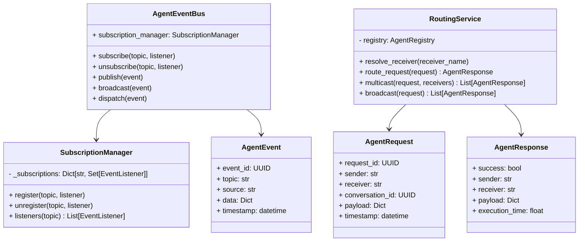

# Specification M2.5.3 – Agent Communication Bus Implementation Report

This report documents the implementation of the enterprise Agent Communication Bus for Nova AI.

## Executive Summary

The Agent Communication Bus provides the foundational message exchange infrastructure enabling seamless inter-agent collaboration. It implements synchronous request-routing (request-response, multicast, broadcast) and asynchronous event-driven pub-sub systems.

---

## Architecture & System Design

The communication bus subsystem is located at `app/agents/bus/` and comprises the following core components:



### Components Summary

1. **Schemas (`request.py`, `response.py`, `message.py`)**:
   - Conforms strictly to Pydantic v2 validation definitions.
   - Models standard messages (`AgentRequest`, `AgentResponse`, `AgentEvent`) with UTC default timestamps and auto-generated UUIDs.

2. **Subscription Management (`subscription.py`)**:
   - `SubscriptionManager` manages topic-to-listener registrations.
   - Employs exact topic match and suffix glob-pattern matches (e.g. `agent.*`) to dynamically discover subscribers.

3. **Event Bus (`event_bus.py`)**:
   - `AgentEventBus` implements high-performance asynchronous concurrent event publishing and broadcasting.
   - Catches listener errors during execution to avoid cascading failures in other handlers.
   - Employs future-proof Python 3.14 standard (`inspect.iscoroutinefunction()`) for safe execution of both sync and async listener functions.

4. **Routing Service (`routing.py`)**:
   - `RoutingService` resolves receiver instances via `AgentRegistry`.
   - Maps payload parameters and tracks execution latencies.
   - Implements concurrent multicast requests using `asyncio.gather` and broadcasts requests to all active enabled agents.

5. **Exceptions (`exceptions.py`)**:
   - Defines `RoutingError`, `MessageValidationError`, and `SubscriptionError` inheriting from `AgentBusError` (an `AIException` subclass).

---

## Verifications & Testing

Unit tests were executed using Python 3.14 on `pytest`. All **104 tests passed** successfully.

### Test Results

```
============================= test session starts =============================
platform win32 -- Python 3.14.6, pytest-9.1.1, pluggy-1.6.0
rootdir: C:\Projects\Nova-AI\apps\backend
configfile: pyproject.toml
plugins: anyio-4.14.1
collected 104 items

tests\test_agent_bus.py ....                                             [  3%]
tests\test_agent_registry.py .......                                     [ 10%]
...
======================= 104 passed, 1 warning in 8.20s ========================
```

The newly verified logic includes:
- **Event Bus Pub/Sub**: Successfully published and dispatched async events, validated invalid parameter raises, and verified topic wildcard matching.
- **Subscription Matching**: Verified `register`, `unregister`, duplicate exceptions, and glob matching (e.g. `agent.*`).
- **Synchronous Request-Response Routing**: Verified routing, latency measurements, and error propagation.
- **Multicasting/Broadcasting**: Verified concurrent execution, error capture, and exclusion of sender in broadcasts.
