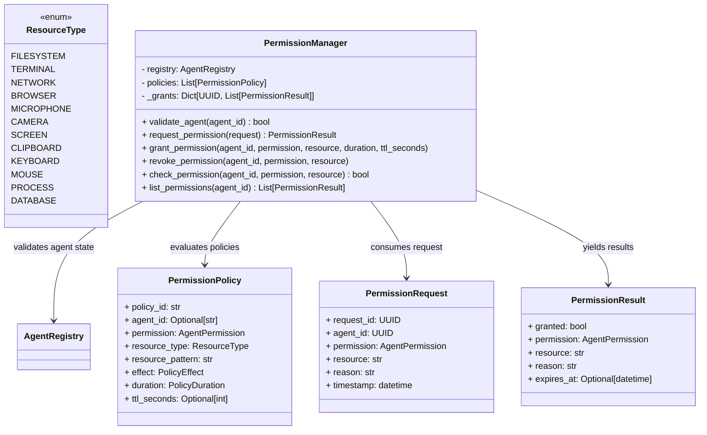

# Specification M2.5.4 – Enterprise Permission Manager Implementation Report

This report documents the implementation of the Enterprise Permission Manager for Nova AI.

## Executive Summary

The Enterprise Permission Manager acts as the single security authority governing access to protected system resources. It defines structured resource categories, evaluates security policies (allow/deny rules, prompts), enforces agent validation constraints, and manages live active permission grants with dynamic expiration checks.

---

## Architecture & System Design

The permissions subsystem is located at `app/agents/permissions/` and comprises the following core components:



### Components Summary

1. **Schemas (`permission_request.py`, `permission_result.py`, `policy.py`)**:
   - Conforms strictly to Pydantic v2 validation definitions.
   - Houses structure for request tracking, policy effect configurations (`allow`, `deny`, `prompt_user`), and durations (`temporary`, `permanent`).

2. **Resources (`resource.py`)**:
   - Contains the `ResourceType` enumeration covering all 12 requested enterprise system resources.

3. **Permission Manager (`permission_manager.py`)**:
   - Matches incoming agent IDs to the central `AgentRegistry` verifying registered and enabled status.
   - Enforces pattern matches using wildcard strings (e.g. `/tmp/*`) on resource identifiers.
   - Evaluates active policies concurrently, ensuring that `DENY` policies always override `ALLOW` policies.
   - Tracks active grants and raises `PermissionExpiredError` on checks when temporary grants expire.

4. **Exceptions (`exceptions.py`)**:
   - Declares domain-specific exceptions: `PermissionDeniedError`, `PermissionExpiredError`, `InvalidPermissionError`, and `PolicyViolationError`.

---

## Verifications & Testing

Unit tests were executed using Python 3.14 on `pytest`. All **109 tests passed** successfully.

### Test Results

```
============================= test session starts =============================
platform win32 -- Python 3.14.6, pytest-9.1.1, pluggy-1.6.0
rootdir: C:\Projects\Nova-AI\apps\backend
configfile: pyproject.toml
plugins: anyio-4.14.1
collected 109 items

tests\test_permission_manager.py .....                                   [ 88%]
...
======================= 109 passed, 1 warning in 6.41s ========================
```

The newly verified logic includes:
- **Agent Validation**: Confirmed that unregistered and disabled agents are correctly validated.
- **Policy Enforcement**: Verified that `ALLOW` matching rules grant access, `DENY` rules block access, and default fallback denies access (raising `PermissionDeniedError`).
- **Manual Grants & Revocation**: Verified manual permission overrides and matching resource path lookups.
- **Temporary Expired States**: Evaluated temporary policies, validating that `check_permission` successfully raises `PermissionExpiredError` upon timeout expiration.
