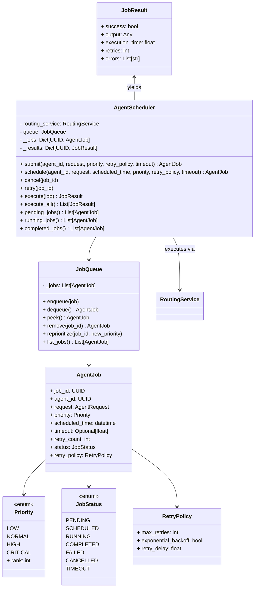

# Specification M2.5.5 – Enterprise Agent Scheduler Implementation Report

This report documents the implementation of the Enterprise Agent Scheduler for Nova AI.

## Executive Summary

The Enterprise Agent Scheduler provides execution management for agent execution tasks (immediate background task submission and delayed scheduling). It incorporates a priority-ordered task queue, execution timeout limits, automated retry policies (with backoff logic), job cancellations, manual retries, and status listings.

---

## Architecture & System Design

The scheduler subsystem is located at `app/agents/scheduler/` and comprises the following core components:



### Components Summary

1. **Schemas (`job.py`, `job_result.py`, `retry_policy.py`)**:
   - Built as Pydantic v2 validation models.
   - Models standard attributes for scheduled jobs, retry configs, and outcome logs.

2. **Priority and Status (`priority.py`, `status.py`)**:
   - Defines `Priority` enum (LOW, NORMAL, HIGH, CRITICAL) mapping to numeric ranks.
   - Defines `JobStatus` enum mapping standard agent job lifecycle execution states.

3. **Job Queue (`job_queue.py`)**:
   - Implements a stable sorting queue that dequeues jobs in order of priority (highest first) and scheduled execution time (earliest first).

4. **Agent Scheduler (`scheduler.py`)**:
   - `submit()` and `schedule()` put tasks in the queue for immediate or delayed runs.
   - `execute()` pops the job, marks status as RUNNING, and executes the target request using `RoutingService`.
   - Timeout constraints are handled via `asyncio.wait_for()`, and execution errors prompt retry loops with exponential backoff delay schedules.
   - Provides status-specific listing checks and allows manual task cancellation/retries.

5. **Exceptions (`exceptions.py`)**:
   - Outlines domain-specific failures: `JobNotFoundError`, `SchedulerError`, `JobTimeoutError`, and `RetryLimitExceededError`.

---

## Verifications & Testing

Unit tests were executed using Python 3.14 on `pytest`. All **115 tests passed** successfully.

### Test Results

```
============================= test session starts =============================
platform win32 -- Python 3.14.6, pytest-9.1.1, pluggy-1.6.0
rootdir: C:\Projects\Nova-AI\apps\backend
configfile: pyproject.toml
plugins: anyio-4.14.1
collected 115 items

tests\test_agent_scheduler.py ......                                     [ 17%]
...
======================= 115 passed, 1 warning in 5.78s ========================
```

The newly verified logic includes:
- **Priority Queueing**: Verified sorting by tier and scheduling timestamp under enqueues.
- **Task Submission & Cancellation**: Validated scheduler submission flows and cancelled states under removals.
- **Execution & Timeouts**: Verified routing executions and timeout limitations.
- **Retry Guidelines**: Simulated failures with backoff wait delays.
- **Manual Resubmission**: Validated resetting and queueing failed tasks.
