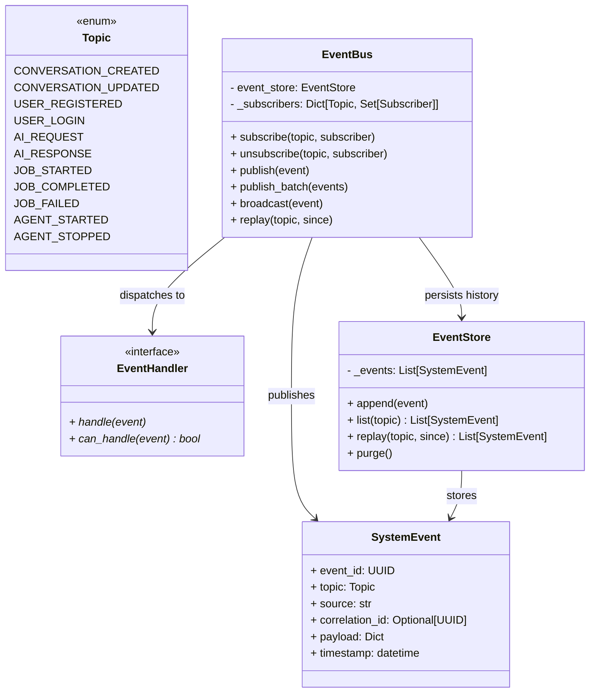

# Specification M2.5.6 – Enterprise System Event Bus Implementation Report

This report documents the implementation of the Enterprise System Event Bus for Nova AI.

## Executive Summary

The Enterprise System Event Bus provides the global event orchestration layer that drives observability, telemetry, auditing, and loose coupling throughout the Nova AI application runtime. It supports in-memory event storage, batch publishing, event broadcasts, custom event handlers (with pre-dispatch validation checks), and historical event replays.

---

## Architecture & System Design

The system event bus subsystem is located at `app/runtime/events/` and comprises the following core components:



### Components Summary

1. **System Topics (`topics.py`)**:
   - Implements the `Topic` enum specifying key lifecycle tracking hooks.

2. **System Event Schema (`event.py`)**:
   - Represents the `SystemEvent` Pydantic v2 validation schema, tracking UUIDs, causal transaction correlations, payloads, and timestamps.

3. **Event Handler Interface (`event_handler.py`)**:
   - Outlines the `EventHandler` interface featuring async `handle()` processing hooks and `can_handle()` pre-dispatch filters.

4. **Event Store (`event_store.py`)**:
   - Implements `EventStore` supporting `append()`, list filtering, and time-bound query listings.

5. **Event Bus (`event_bus.py`)**:
   - Implements `EventBus` executing concurrent dispatches to matching subscribers.
   - Bypasses topic verification during broadcasts to deliver events to all registered handlers.
   - Triggers historical replay notifications back to matching subscribers.

6. **Exceptions (`exceptions.py`)**:
   - Exposes `EventPublishError`, `EventReplayError`, and `HandlerError` inheriting from `SystemEventError` (an `AIException` subclass).

---

## Verifications & Testing

Unit tests were executed using Python 3.14 on `pytest`. All **120 tests passed** successfully.

### Test Results

```
============================= test session starts =============================
platform win32 -- Python 3.14.6, pytest-9.1.1, pluggy-1.6.0
rootdir: C:\Projects\Nova-AI\apps\backend
configfile: pyproject.toml
plugins: anyio-4.14.1
collected 120 items

tests\test_system_event_bus.py .....                                     [ 94%]
...
======================= 120 passed, 1 warning in 5.44s ========================
```

The newly verified logic includes:
- **Pub/Sub Subscriptions**: Verified standard callback listener invocations, exact match registrations, and unsubscribing.
- **Batch Publishing**: Verified concurrent publishing of arrays of events.
- **Observability Broadcasts**: Broadcasted events were delivered to all registered handlers and persisted.
- **Historical Replays**: Verified chronologically ordered replaying of past events filtered by topic and timestamp constraints.
- **Errors Handling**: Correctly raised `EventPublishError` on invalid payloads and wrapped handler failures under `HandlerError`.
