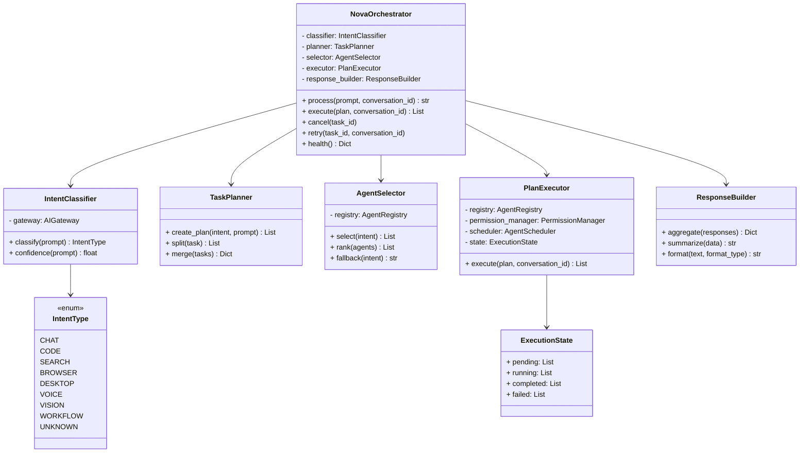

# Specification M2.5.7 – Nova Orchestrator Implementation Report

This report documents the implementation of the Nova Orchestrator for Nova AI.

## Executive Summary

The Nova Orchestrator serves as the central coordination system, orchestrating agent activities without executing any domain business logic directly. It integrates with the Agent Registry, Permission Manager, Scheduler, Communication Bus, and AI Gateway to achieve goal-driven multi-step orchestration.

---

## Architecture & System Design

The orchestrator package is located at `app/orchestrator/` and comprises the following decoupled modules:



### Components Summary

1. **Intent Classification (`intent.py`)**:
   - Implements `IntentType` enum spanning all required interaction modes.
   - Implements `IntentClassifier` leveraging static keyword filters and prompt queries routed via the `AIGateway`.

2. **Task Planning (`planner.py`)**:
   - Implements `TaskPlanner` defining plan maps, splitting compound tasks into sub-tasks, and merging step results.

3. **Agent Selection (`selector.py`)**:
   - Implements `AgentSelector` querying the `AgentRegistry` for capability-matched candidates, ranking them by descriptor priority, and resolving fallbacks.

4. **Execution Management (`executor.py`, `state.py`, `task.py`)**:
   - Implements `PlanExecutor` executing planned tasks sequentially.
   - Validates agent permission requirements dynamically using the `PermissionManager`.
   - Submits execution requests to the `AgentScheduler` which routes jobs through the inter-agent `RoutingService` communication bus.
   - Stores tracking structures inside the `ExecutionState` (pending, running, completed, failed lists).

5. **Response Aggregation (`response_builder.py`)**:
   - Implements `ResponseBuilder` collecting individual task responses, producing unified execution summaries, and formatting markdown outputs.

6. **Nova Orchestrator (`orchestrator.py`)**:
   - Integrates and coordinates all sub-components through the `process()` entry point.
   - Provides lifecycle control functions (`cancel()`, `retry()`) and service diagnostics (`health()`).

---

## Verifications & Testing

Unit tests were executed using Python 3.14 on `pytest`. All **125 tests passed** successfully.

### Test Results

```
============================= test session starts =============================
platform win32 -- Python 3.14.6, pytest-9.1.1, pluggy-1.6.0
rootdir: C:\Projects\Nova-AI\apps\backend
configfile: pyproject.toml
plugins: anyio-4.14.1
collected 125 items

tests\test_orchestrator.py .....                                         [ 81%]
...
======================= 125 passed, 1 warning in 7.36s ========================
```

The newly verified logic includes:
- **Intent Classifier**: Verified keyword detection and mock AI Gateway query routing.
- **Task Planner**: Verified plan generation, splitting, and result merging.
- **Agent Selector**: Verified registry-based capability matching, priority ranking, and fallbacks.
- **Orchestration Coordination**: Verified routing of chat and code tasks, checking agent permissions, and scheduler submissions.
- **Response Builders**: Verified outcome aggregation, summary aggregation, and markdown formats.
