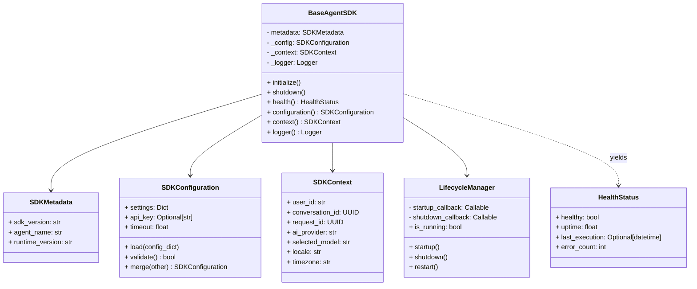

# Specification M2.6.1 – Enterprise Agent SDK Foundation Implementation Report

This report documents the implementation of the Enterprise Agent SDK Foundation for Nova AI.

## Executive Summary

The Enterprise Agent SDK Foundation serves as the common toolkit inherited by every future AI Agent in the Nova AI runtime. It provides standardised versioning, configuration management, execution tracing context, health telemetry tracking, and startup/shutdown lifecycle controls.

---

## Architecture & System Design

The SDK foundation package is located at `app/agent_sdk/` and comprises the following decoupled modules:



### Components Summary

1. **Metadata Versioning (`metadata.py`)**:
   - Implements `SDKMetadata` tracking SDK, agent, and runtime version details.

2. **Configuration Management (`configuration.py`)**:
   - Implements `SDKConfiguration` to load dictionary parameters, validate timeout constraints, and merge default settings with custom configurations.

3. **Tracing Context (`context.py`)**:
   - Implements `SDKContext` validating user, request, conversation, locales, and model details to ensure request tracing capability.

4. **Lifecycle Manager (`lifecycle.py`)**:
   - Implements `LifecycleManager` executing async start, stop, and restart transitions with callback execution tracking.

5. **Health Telemetry (`health.py`)**:
   - Implements `HealthStatus` monitoring uptime, last run times, and cumulative error counts.

6. **Base SDK (`base_sdk.py`)**:
   - Implements the base `BaseAgentSDK` class containing configurations, state trackers, active contexts, loggers, and lifecycles.

7. **Exceptions (`exceptions.py`)**:
   - Exposes domain-specific SDK errors: `SDKInitializationError`, `SDKConfigurationError`, and `SDKRuntimeError`.

---

## Verifications & Testing

Unit tests were executed using Python 3.14 on `pytest`. All **129 tests passed** successfully.

### Test Results

```
============================= test session starts =============================
platform win32 -- Python 3.14.6, pytest-9.1.1, pluggy-1.6.0
rootdir: C:\Projects\Nova-AI\apps\backend
configfile: pyproject.toml
plugins: anyio-4.14.1
collected 129 items

tests\test_agent_sdk.py ....                                             [ 18%]
...
======================= 129 passed, 1 warning in 10.18s =======================
```

The newly verified logic includes:
- **SDK Metadata**: Verified version default bindings.
- **Config Validations**: Verified validation rules and settings merges.
- **Execution Tracing**: Verified request tracing contexts and timestamp markings.
- **Transitions Controls**: Verified startup, shutdown, and restart workflows, and double-startup exceptions.
