# Specification M2.6.2 – Enterprise AI Helper Library Implementation Report

This report documents the implementation of the Enterprise AI Helper Library extension for the Agent SDK in Nova AI.

## Executive Summary

The Enterprise AI Helper Library provides unified, interface-driven helper abstractions wraps over the central `AIGateway` routing service. This library serves as the single communications layer that every future concrete AI Agent (such as Software, Browser, Memory, Vision, or Research Agents) inherits and uses to interact with underlying local open-source models, satisfying the ₹0 mandatory operating cost constraints.

---

## Architecture & System Design

The helper library package is located at `app/agent_sdk/ai/` and comprises the following decoupled modules:

```mermaid
classDiagram
    class ChatHelper {
        - gateway: AIGateway
        + chat(prompt, model) str
        + chat_with_system_prompt(prompt, system_prompt, model) str
        + multi_turn_chat(messages, model) str
        + structured_chat(prompt, schema, model) Dict
        + conversation_chat(prompt, conversation_id, model) str
    }

    class StreamingHelper {
        - gateway: AIGateway
        + stream(prompt, model) AsyncGenerator[str]
        + stream_chunks(prompt, model) AsyncGenerator[StreamingChunk]
        + stream_completion(messages, model) AsyncGenerator[str]
        + cancel_stream(task)
    }

    class EmbeddingHelper {
        - gateway: AIGateway
        + embed(text, model) List[float]
        + embed_documents(documents, model) List[List[float]]
        + similarity(text1, text2, model) float
        + cosine_similarity(vec1, vec2) float
    }

    class VisionHelper {
        - gateway: AIGateway
        + describe_image(image_data, model) str
        + analyze_ui(image_data, model) Dict
        + ocr(image_data, model) str
        + detect_objects(image_data, model) List
    }

    class CompletionHelper {
        - gateway: AIGateway
        - _chat_helper: ChatHelper
        + complete(prompt, model) str
        + summarize(text, max_length, model) str
        + rewrite(text, tone, model) str
        + explain(topic, target_audience, model) str
        + translate(text, target_lang, model) str
    }

    class ModelHelper {
        - gateway: AIGateway
        + list_models() List[str]
        + current_model() str
        + current_provider() str
        + model_capabilities(model_name) List[str]
    }

    class TokenHelper {
        - gateway: AIGateway
        + estimate(text) int
        + remaining_context(text, model_name) int
        + truncate(text, max_tokens) str
    }

    class BaseAgentSDK {
        <<SDK base>>
    }

    BaseAgentSDK --> ChatHelper : exposes
    BaseAgentSDK --> StreamingHelper : exposes
    BaseAgentSDK --> EmbeddingHelper : exposes
    BaseAgentSDK --> VisionHelper : exposes
    BaseAgentSDK --> CompletionHelper : exposes
    BaseAgentSDK --> ModelHelper : exposes
    BaseAgentSDK --> TokenHelper : exposes
```



### Components Summary

1. **Chat Completion Wrapper (`chat_helper.py`)**:
   - Implements `ChatHelper` executing standard prompts, multi-turn dialogue, system instructions, structured JSON extraction and parsing, and session-traced conversations.

2. **Async Token Streaming (`streaming_helper.py`)**:
   - Implements `StreamingHelper` yielding chronological text delta fragments or raw `StreamingChunk` frames natively.

3. **Text Embeddings & Vector Calculations (`embedding_helper.py`)**:
   - Implements `EmbeddingHelper` calculation options for cosine similarity coefficients. Incorporates clear interface-compatible TODO integration tags.

4. **Vision Capabilities Wrappers (`vision_helper.py`)**:
   - Implements interface-ready wrappers for describing visual inputs, performing OCR, object classification, and screen coordinate parsing (UI screenshots), ready for future integrations.

5. **Text Transformation Tasks (`completion_helper.py`)**:
   - Implements `CompletionHelper` templates for text summaries, audience adjustments/explanations, style rewrites, and language translations.

6. **Registry Checks (`model_helper.py`)**:
   - Implements `ModelHelper` querying active model configurations, fallback default resolutions, and capability maps.

7. **Token Estimators & Truncations (`token_helper.py`)**:
   - Implements lightweight token counters and character truncation filters based on context window limits.

8. **Exceptions (`exceptions.py`)**:
   - Exposes AI Helper library exceptions: `AIHelperError`, `ModelUnavailableError`, `StreamingError`, `EmbeddingError`, and `VisionError`.

---

## Verifications & Testing

Unit tests were executed using Python 3.14 on `pytest`. All **136 tests passed** successfully.

### Test Results

```
============================= test session starts =============================
platform win32 -- Python 3.14.6, pytest-9.1.1, pluggy-1.6.0
rootdir: C:\Projects\Nova-AI\apps\backend
configfile: pyproject.toml
plugins: anyio-4.14.1
collected 136 items

tests\test_agent_sdk_ai.py .......                                       [ 22%]
...
======================= 136 passed, 1 warning in 6.26s ========================
```

The newly verified logic includes:
- **Chat Wrappers**: Verified standard prompt outputs, system prompting, multi-turn contexts, conversation routing, and JSON schema extraction.
- **Completer Prompts**: Summarization, explaining, rewrite tones, and translations.
- **Model Registry Lookup**: Current model checks, active default providers, and model capabilities.
- **Context Headrooms**: character-based token estimates, remaining context headrooms, and truncations.
- **Async Streams**: Chronological text streaming chunk generators.
- **Embedding Vectors**: Embedding placeholders and cosine similarity math.
- **Vision Wrappers**: describes images, ui parses, OCR placeholders, and validation checks.
