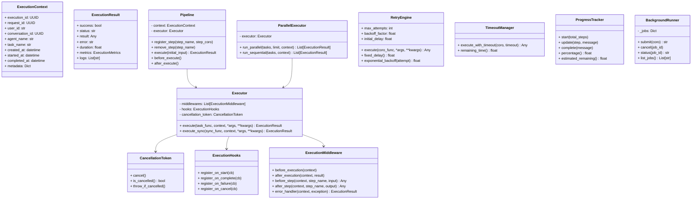

# Specification M2.6.4 – Enterprise Execution Framework Implementation Report

This report documents the implementation of the Enterprise Execution Framework for Nova AI.

## Executive Summary

The Enterprise Execution Framework provides the runtime orchestration core for all future concrete AI agents (Software, Browser, Vision, Voice, Memory, Research, Desktop, etc.). By design, agents do not run task operations directly; they must run tasks through this framework.

Consistent with the ₹0 mandatory operating cost requirement, the framework operates entirely offline, has zero external dependencies, and supports local open-source model execution.

---

## Architecture & System Design

The package is located at `app/agent_sdk/execution/` and comprises the following decoupled modules:



### Components Summary

1. **Context & Results Models (`context.py`, `result.py`, `metrics.py`)**:
   - Pydantic v2 schemas tracking execution IDs, metadata parameters, durations, retry logs, and telemetry.

2. **Sequential Step Pipeline (`pipeline.py`)**:
   - Chimes registered task coroutines sequentially, propagating step inputs to outputs with unified logs.

3. **Single Task Executor (`executor.py`)**:
   - Manages single-target executions, wrapping pre/post-step middleware hooks, status signals, and callbacks.

4. **Concurrencies & Parallelism (`parallel_executor.py`)**:
   - Executes multiple task collections concurrently using semaphores to cap maximum active workers.

5. **Retry Engine (`retry.py`)**:
   - Implements attempts limits, fixed pauses, and exponential backoff timers.

6. **Timeout Manager (`timeout.py`)**:
   - Uses `asyncio.wait_for` loops to guarantee task completion limits.

7. **Cancellation Signal (`cancellation.py`)**:
   - Implements thread/coroutine token indicators.

8. **Progress Tracker (`progress.py`)**:
   - Tracks percentages and estimates remaining duration based on step rate calculations.

9. **Middleware & Hooks base (`middleware.py`, `hooks.py`)**:
   - Defines extensibility hooks for step tracing and custom error recovery strategies.

10. **Background Jobs Runner (`background_runner.py`)**:
    - Spawns background tasks.

---

## Verification & Testing

Unit tests were executed using Python 3.14 on `pytest`. All **150 tests passed** successfully with zero deprecation warnings.

### Test Results

```
============================= test session starts =============================
platform win32 -- Python 3.14.6, pytest-9.1.1, pluggy-1.6.0
rootdir: C:\Projects\Nova-AI\apps\backend
configfile: pyproject.toml
plugins: anyio-4.14.1
collected 150 items

tests\test_execution_framework.py ........                               [ 59%]
...
====================== 150 passed, 1 warning in 8.18s =======================
```

The verified logic includes:
- **Pipeline Step Chaining**: Verified sequential steps executing, logs tracing, and input/output propagation.
- **Retry Attempts**: Verified successful transient recovery on retry loops and `RetryExceededError` triggers.
- **Timeouts**: Confirmed `TimeoutError` raise on slow coroutine tasks and remaining time math.
- **Concurrencies**: Checked parallel executions within semaphore limits.
- **Cancellation**: Confirmed immediate execution stops and `"cancelled"` statuses mapping.
- **Progress telemetries**: Checked percentage changes and remaining duration estimates.
- **Background runners**: Submitted background tasks, verified `"running"` statuses, and successfully cancelled jobs.
- **Middleware & Hooks callbacks**: Confirmed `before_execution`, `before_step` (mutating input values), `after_step` (mutating output values), and event hooks `on_start` execute in order.
