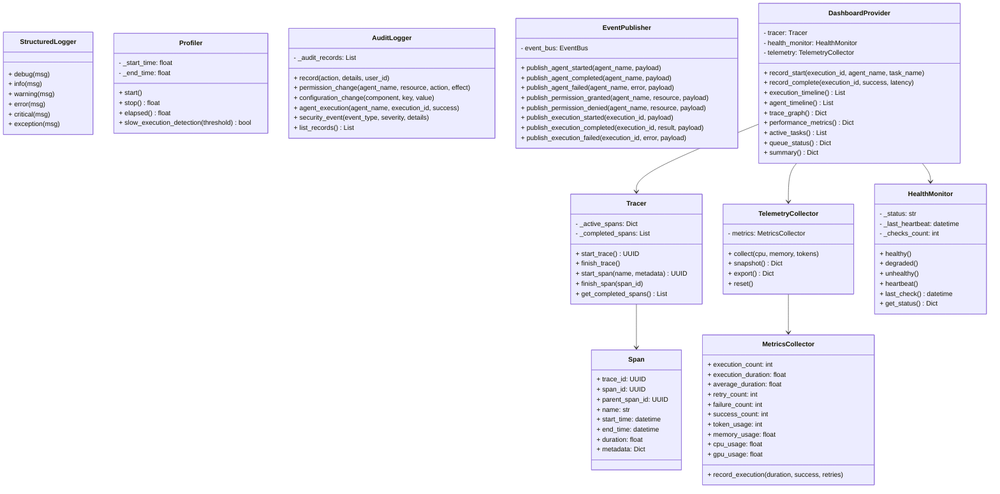

# Specification M2.6.5 – Enterprise Observability SDK Implementation Report

This report documents the implementation of the Enterprise Observability SDK for Nova AI.

## Executive Summary

The Enterprise Observability SDK provides the unified monitoring, logging, tracing, auditing, and telemetry layer for all future concrete AI agents. Every agent inherits these capabilities to report health, publish runtime events, and log transactions.

In alignment with the ₹0 mandatory operating cost requirement, the framework operates entirely offline, has zero external dependencies, and exposes clean, structured API models easily consumable by future React/Electron frontend dashboards.

---

## Architecture & System Design

The package is located at `app/agent_sdk/observability/` and comprises the following decoupled modules:



### Components Summary

1. **Structured JSON Logger (`logger.py`)**:
   - Implements `StructuredLogger` outputting structured logs with timestamp, execution, request, user, conversation, agent, task, severity, and metadata context.

2. **Metrics Collector (`metrics.py`)**:
   - Captures counts, success/failure counts, and execution durations.

3. **Trace Graphing (`tracer.py`, `span.py`)**:
   - `Tracer` indexes execution hierarchies via nested spans (`Span`).

4. **Telemetry Snapshotter (`telemetry.py`)**:
   - Samples CPU, Memory, GPU, and token usage, exporting structured snapshots.

5. **Slow Execution Profiler (`profiler.py`)**:
   - Detects execution blocks exceeding configurable latency limits.

6. **Heartbeat Health Monitor (`health_monitor.py`)**:
   - Monitors heartbeat states (`healthy`, `degraded`, `unhealthy`).

7. **Security Audits (`audit.py`)**:
   - Logs security-relevant transactions (permission variations, configurations, security blocks).

8. **Event Publisher Integration (`event_publisher.py`)**:
   - Translates M2.6.5 lifecycle events into Pydantic-validated `SystemEvent` instances and dispatches them on the existing System Event Bus.

9. **Dashboard Aggregations (`dashboard.py`)**:
   - Provides clean APIs (nodes, DAG edges, timelines, resource metrics) ready for React/Electron frontend rendering.

---

## Verification & Testing

Unit tests were executed using Python 3.14 on `pytest`. All **159 tests passed** successfully.

### Test Results

```
============================= test session starts =============================
platform win32 -- Python 3.14.6, pytest-9.1.1, pluggy-1.6.0
rootdir: C:\Projects\Nova-AI\apps\backend
configfile: pyproject.toml
plugins: anyio-4.14.1
collected 159 items

tests\test_observability_sdk.py .........                                [ 74%]
...
======================= 159 passed, 1 warning in 10.43s =======================
```

The verified logic includes:
- **JSON Formatting**: Verified structured metadata mappings in stdout logs.
- **Trace Spans DAG**: Confirmed child-parent nesting hierarchy in tracers.
- **Auditing Logs**: Verified permission change records, configuration logs, and security alerts.
- **Telemetry Snapshots**: Sampled CPU/Memory profiles and verified token calculations.
- **Heartbeat Statuses**: Verified state transition monitoring.
- **Event Bus Link**: Dispatched all 8 lifecycle events onto the System Event Bus and verified subscribers.
- **UI Aggregators**: Fetched DAG nodes/edges trace graphs, latency summary calculations, timelines, and active tasks.
