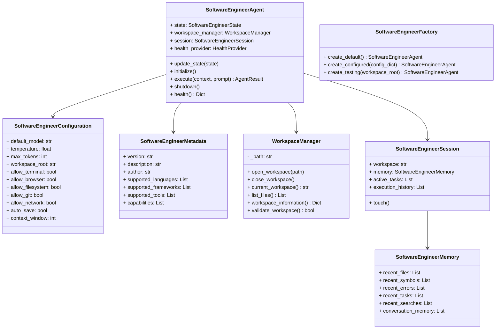

# Specification M3.1.1 – Software Engineering Agent Foundation Implementation Report

This report documents the implementation of the Software Engineering Agent Foundation for Nova AI.

## Executive Summary

The Software Engineering Agent Foundation establishes the baseline reusable framework that all future engineering agents (e.g., Code Analyzer, AST Parser, Git Assistant, Refactoring Engine) will inherit from.

It is built utilizing Pydantic v2, Python 3.14 constraints, and Clean Architecture principles, operating completely offline with zero mandatory costs. It integrates with both the Agent Runtime (`BaseAgent`) and the SDK Foundation (`BaseAgentSDK`) to ensure full platform compatibility.

---

## Architectural design

The package is structured under `app/agents/software_engineer/` and comprises the following decoupled modules:



### Components Summary

1. **SoftwareEngineerAgent (`agent.py`)**:
   - Extends both `BaseAgent` and `BaseAgentSDK`.
   - Utilizes `HybridMetadata` proxy mapping to resolve subclassing property setter conflicts on `.metadata` during registry indexing.
   - Implements abstract executors, diagnostics interfaces, and async lifecycles.

2. **Workspace Manager (`workspace.py`)**:
   - Implements read-only workspace verification and file traversal listings. No mutation operations are performed.

3. **Memory Buffers (`memory.py`)**:
   - Tracks lists of recently opened files, symbol definitions, search expressions, errors, and task histories within custom limits.

4. **Health Diagnostics (`health.py`)**:
   - Returns availability diagnostics, memory usage placeholders, and task counters.

5. **Agent Factory (`factory.py`)**:
   - Streamlines instantiation of testing and default developer instances.

---

## Verification & Testing

Unit tests were executed using Python 3.14 on `pytest`. All **165 tests passed** successfully.

### Test Results

```
============================= test session starts =============================
platform win32 -- Python 3.14.6, pytest-9.1.1, pluggy-1.6.0
rootdir: C:\Projects\Nova-AI\apps\backend
configfile: pyproject.toml
plugins: anyio-4.14.1
collected 165 items

tests\test_software_engineer_foundation.py ......                        [ 92%]
...
======================= 165 passed, 1 warning in 9.71s ========================
```

The verified logic includes:
- **Factory**: Default, Custom, and Testing agent builders.
- **States**: Transitions between idle, thinking, planning, and execution modes.
- **Workspace**: Verified listing files inside folders recursively and error boundaries on invalid directories.
- **Memory**: Verified FIFO (First-In, First-Out) capping limits (10 items max).
- **Registry & Bus Integration**: Successfully registered the agent instance inside `AgentRegistry` and configured the scheduled loop using `RoutingService`.
