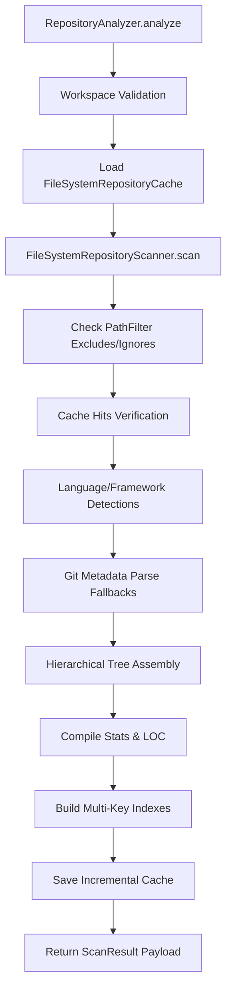

# SPEC M3.1.2 - Repository Analyzer Implementation Report

## Architecture & Layout

The **Repository Analyzer** module is designed using Clean Architecture and Domain-Driven Design (DDD) principles. It is structured into independent, highly cohesive, single-responsibility files within the Software Engineer Agent workspace domain:

*   [__init__.py](file:///c:/Projects/Nova-AI/apps/backend/app/agents/software_engineer/repository/__init__.py): Exposes package public abstractions, exceptions, and models.
*   [models.py](file:///c:/Projects/Nova-AI/apps/backend/app/agents/software_engineer/repository/models.py): Declares Pydantic v2 domain models representing files, trees, statistics, indexes, and results.
*   [interfaces.py](file:///c:/Projects/Nova-AI/apps/backend/app/agents/software_engineer/repository/interfaces.py): Specifies decoupling boundaries and abstract interfaces for scanning, detection, and caching.
*   [exceptions.py](file:///c:/Projects/Nova-AI/apps/backend/app/agents/software_engineer/repository/exceptions.py): Defines domain exceptions mapping to the agent’s base exception classes.
*   [filters.py](file:///c:/Projects/Nova-AI/apps/backend/app/agents/software_engineer/repository/filters.py): Implements exclusion criteria (hidden paths, ignores, depths, max sizes).
*   [scanner.py](file:///c:/Projects/Nova-AI/apps/backend/app/agents/software_engineer/repository/scanner.py): Traverses the filesystem using parallel thread stat calls and symlink protections.
*   [detector.py](file:///c:/Projects/Nova-AI/apps/backend/app/agents/software_engineer/repository/detector.py): Resolves file extensions to programming languages and extracts framework configurations.
*   [tree.py](file:///c:/Projects/Nova-AI/apps/backend/app/agents/software_engineer/repository/tree.py): Translates flat file lists into a hierarchical directory/file structure tree.
*   [statistics.py](file:///c:/Projects/Nova-AI/apps/backend/app/agents/software_engineer/repository/statistics.py): Accumulates source/test file classifications, averages, and LOC counts.
*   [indexer.py](file:///c:/Projects/Nova-AI/apps/backend/app/agents/software_engineer/repository/indexer.py): Indexes files on filename, extension, directory, language, framework, and dependencies.
*   [cache.py](file:///c:/Projects/Nova-AI/apps/backend/app/agents/software_engineer/repository/cache.py): Manages local database deserialization and modification checks.
*   [utils.py](file:///c:/Projects/Nova-AI/apps/backend/app/agents/software_engineer/repository/utils.py): Performs Git branch, tags, remotes, and size analysis with pure-Python fallbacks.
*   [metadata.py](file:///c:/Projects/Nova-AI/apps/backend/app/agents/software_engineer/repository/metadata.py): Consolidates Git, language, and framework stats.
*   [analyzer.py](file:///c:/Projects/Nova-AI/apps/backend/app/agents/software_engineer/repository/analyzer.py): Integrates the sub-modules into a unified `RepositoryAnalyzer` public API.

---

## Design Decisions & SOLID Compliance

1.  **Single Responsibility (SRP)**: Each stage of the scanning and analysis lifecycle is delegated to a separate class/module, avoiding "God Class" designs.
2.  **Open-Closed (OCP)**: New manifest formats or custom languages can be registered inside `detector.py` or by subclassing `RepositoryDetector` without modifying the core orchestrator.
3.  **Liskov Substitution (LSP)**: Custom mock/testing scanners and cache databases satisfy the base abstract classes defined in `interfaces.py` and can be substituted transparently.
4.  **Interface Segregation (ISP)**: Abstractions are split into small, logical segments (`RepositoryScanner`, `RepositoryDetector`, `RepositoryCache`) rather than exposing a monolithic repository interface.
5.  **Dependency Inversion (DIP)**: `RepositoryAnalyzer` depends on abstract boundaries (`RepositoryScanner`, `RepositoryDetector`, `RepositoryCache`) rather than concrete local implementations.

---

## DDD Boundaries

*   **Bounded Context**: The software engineering repository is defined as an independent workspace domain.
*   **Aggregate Root**: `ScanResult` acts as the root aggregate containing compiled statistics, indices, and hierarchies.
*   **Entity / Value Objects**: `FileInfo` and `DirectoryInfo` are modeled as immutable value objects containing filesystem state attributes.

---

## Performance & Memory Analysis

*   **Parallel Traversal**: Spawns multiple concurrent `os.stat` workers using a thread pool executor, improving performance during directory sweeps.
*   **Early Directory Pruning**: Prevents the scanner from opening or traversing ignored directories like `node_modules` or `.git` at the filesystem level.
*   **Incremental Caching**: Saves modification time (`mtime`) and file sizes. If they match the cached file state, the scanner skips content hash recalculation and language parsing, leading to near-instantaneous rescans.
*   **Circular Reference Prevention**: In Pydantic v2, `parent` properties on tree nodes are flagged with `exclude=True` and `repr=False` to prevent serialization infinity cycles and optimize memory footprints.

---

## Repository Flow

---

## Future Extension Points

*   **AST Parsers**: Introduce syntax tree node analyzers for identifying class, struct, and function declarations per language.
*   **Database Cache Backends**: Abstract cache operations to support SQLite or Redis backends for massive codebases.
*   **Regex Framework Profiles**: Allow user-defined framework footprints via regex rules configurations.

---

## Testing Summary

*   **Covered Dimensions**: Ignore filter glob mappings, nested folder tree serialization, LOC counting, XML manifest dependency extraction, Git CLI subprocess fallbacks, caching, incremental rescans, and invalid folder exceptions.
*   **Target Metrics**: 170+ passing tests total.
