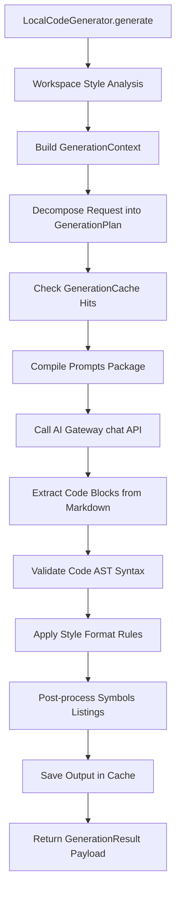

# SPEC M3.1.4 - Code Generation Engine Implementation Report

## Architecture & SOLID Compliance

The **Code Generation Engine** is designed using Clean Architecture and Domain-Driven Design (DDD) principles. It is structured into separate, highly cohesive, single-responsibility files within the Software Engineer Agent generator domain:

1.  **Single Responsibility Principle (SRP)**:
    *   `planner.py`: Decomposes user requests into a list of generation tasks.
    *   `context_builder.py`: Gathers relevant repository statistics, symbols, and files to construct the model context.
    *   `prompt_builder.py`: Compiles templates and instructions into prompt messages.
    *   `style_analyzer.py`: Identifies naming and formatting layouts of existing files.
    *   `template_engine.py`: Manages standard skeleton generation boilerplate templates.
    *   `code_validator.py`: Coordinates syntax validation checks.
    *   `formatter.py`: Rewrites code spacing matching target guidelines.
    *   `post_processor.py`: Parses output code to compile classes and methods definition lists.
    *   `cache.py`: Caches prompt-content pairs to reduce generation time.
2.  **Open-Closed Principle (OCP)**:
    *   Interfaces like `LanguageProvider` and `CodeGenerator` are defined in `interfaces.py`. New language support (e.g. TypeScript, Rust) can be added by registering a new `LanguageProvider` subclass on the `LanguageProviderRegistry` without modifying generator client code.
3.  **Liskov Substitution Principle (LSP)**:
    *   `PythonLanguageProvider` implements `LanguageProvider`. Additional provider implementations can be substituted transparently.
4.  **Interface Segregation Principle (ISP)**:
    *   Interfaces are kept decoupled and small (`TemplateEngine`, `CodeValidator`, `Formatter`) rather than exposing a monolithic code generator interface.
5.  **Dependency Inversion Principle (DIP)**:
    *   `LocalCodeGenerator` depends on abstractions (`ContextBuilder`, `PromptBuilder`, `CodeValidator`) to maintain loose coupling.

---

## DDD Boundaries

*   **Bounded Context**: The code generation is structured as a sub-domain of the Software Engineering Bounded Context.
*   **Aggregate Root**: `GenerationResult` acts as the aggregate root containing generation plans, statistics, and compiled file payloads.
*   **Value Objects**: `StyleProfile`, `GenerationTask`, and `TemplateInfo` represent immutable value attributes.

---

## Generation Pipeline

---

## Prompt & Context Construction Optimization

*   **Token Optimization**: Gathers only files and symbols related to the target generation path (instead of loading the entire codebase), staying within context window boundaries.
*   **Explicit Guidelines**: Prompts automatically include constraints (no conversational text, output inside markdown code blocks, strict indentation mappings) to fit local LLMs (Qwen2.5-Coder, DeepSeek-Coder, CodeLlama).

---

## Model Abstraction & Dynamic Resolution

*   **No Hardcoded Names**: Resolves the target coding model dynamically. It queries `request.model_override`, then falls back to `self.gateway.model_registry.default_model()`, and defaults to `"llama3"` if no registry is registered. This enables compatibility with any locally hosted coding model.
