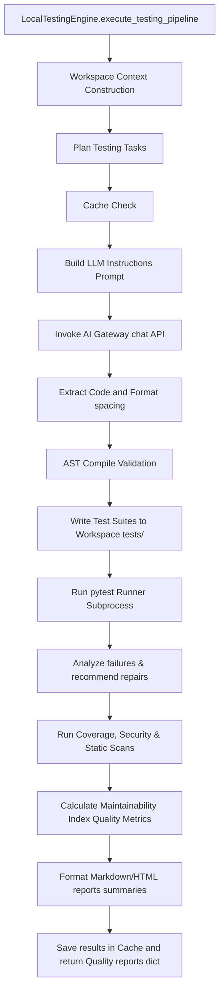

# SPEC M3.1.6 - Testing & Quality Assurance Engine Implementation Report

## Architecture & SOLID Compliance

The **Testing & Quality Assurance Engine** provides complete automatic unit/integration/API testing and resource auditing for the Software Engineer Agent workspace:

1.  **Single Responsibility Principle (SRP)**:
    *   `planner.py`: Compiles testing tasks plans.
    *   `unit_generator.py`, `integration_generator.py`, `api_generator.py`, `ui_generator.py`: Specific categorised test code templates generators.
    *   `coverage.py`: Analyzes branch coverage and untested code lines.
    *   `runner.py` & `executor.py`: Isolates test executions and command subprocess calls.
    *   `security_scanner.py`: Inspects files statically for passwords, injections, and `eval`.
2.  **Open-Closed Principle (OCP)**:
    *   Interfaces defined in `interfaces.py` permit adding support for other testing libraries (e.g. `unittest` or Javascript Jest engines) by registering concrete `TestRunner` and `TestGenerator` subclasses.
3.  **Liskov Substitution Principle (LSP)**:
    *   `PytestTestRunner` implements `TestRunner`. Alternate runners can be substituted transparently.
4.  **Interface Segregation Principle (ISP)**:
    *   Distinct modular interfaces (`CoverageAnalyzer`, `SecurityScanner`, `FailureAnalyzer`) prevent interface bloat.
5.  **Dependency Inversion Principle (DIP)**:
    *   `LocalTestingEngine` coordinates components through abstractions rather than concrete subclasses.

---

## DDD Boundaries

*   **Bounded Context**: The testing engine is modeled as a core sub-domain of the Software Engineering Bounded Context.
*   **Aggregate Root**: `TestSuite` acts as the aggregate root containing executions results.
*   **Value Objects**: `CoverageReport`, `BenchmarkReport`, and `SecurityFinding` denote snapshots value attributes.

---

## Testing & Quality Verification Pipeline

The orchestration flow runs in the following order:

---

## Security Scan & Static Analysis

*   **Security Scans**: The engine performs regular expression inspections scanning target code lines for:
    *   SQL injection pattern indicators (e.g. formatted query variables).
    *   Hardcoded credentials or API keys signatures.
    *   Dangerous runtime evaluation hooks (e.g. `eval` or unsafe pickling).
*   **Static Scans**: Analyzes style compliances and architectural layer imports.

---

## Resource Latency & Quality Metrics

*   **Benchmark Engine**: Measures execution latency, startup delays, and memory byte usage profiles.
*   **Quality Metrics Engine**: Calculates Maintainability Indexes (derived from cyclomatic complexity and code line metrics), documentation qualities, and technical debt ratios.
