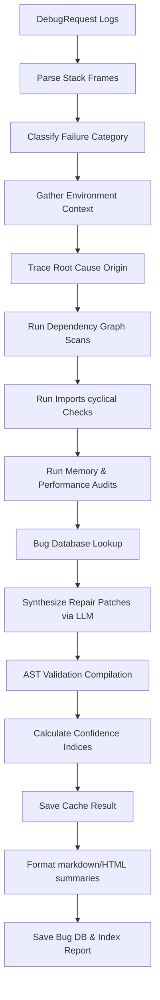

# SPEC M3.1.7 - Debugging & Root Cause Analysis Engine Implementation Report

## Architecture & SOLID Compliance
The **Debugging & Root Cause Analysis Engine** provides offline diagnosis of failures and root cause tracing for the Software Engineer Agent workspace:

1.  **Single Responsibility Principle (SRP)**:
    *   `stacktrace_parser.py`: Extracts trace call frames.
    *   `failure_classifier.py`: Maps failures categories.
    *   `root_cause.py`: Detects fault origins.
    *   `repair_generator.py`: Estimates code fixes.
    *   `repair_validator.py`: Compiles checking syntax correctness.
2.  **Open-Closed Principle (OCP)**:
    *   Abstractions in `interfaces.py` allow adding support for foreign stack languages (e.g. JavaScript or Go exceptions parsing) by swapping `StackTraceParser` subclasses.
3.  **Liskov Substitution Principle (LSP)**:
    *   `PythonStackTraceParser` implements `StackTraceParser`. Alternate parsers are substituted cleanly.
4.  **Interface Segregation Principle (ISP)**:
    *   Fine-grained interfaces (`MemoryAnalyzer`, `PerformanceAnalyzer`, `ImportValidator`) keep components decoupled.
5.  **Dependency Inversion Principle (DIP)**:
    *   The `LocalDebuggingEngine` coordinates subcomponents by referencing abstract interfaces.

---

## DDD Boundaries
*   **Bounded Context**: Root Cause and failure debugging operations form a core sub-domain of the Software Engineering Bounded Context.
*   **Aggregate Root**: `DebugSession` aggregates diagnostics contexts, failures classifications, and repair validation indicators.
*   **Value Objects**: `StackFrame`, `StackTrace`, and `ConfidenceReport` define immutable value states.

---

## Debug & Repair Pipelines
The orchestrator walks through a complete 15-step pipeline:

---

## Confidence Model
The `ConfidenceReport` aggregates estimations:
*   **Root Cause Confidence**: Evaluated based on tracing the innermost workspace file from stack frames.
*   **Repair Confidence**: Derived from LLM estimation and compile checks.
*   **Overall success probability**: Formula combining root cause trace accuracy and compile correctness results.

---

## Caching Strategy
*   **Session Cache**: `debugging_cache.json` caches parsed results maps keyed by SHA-256 traceback hashes.
*   **Bug Database Cache**: `bug_database.json` maintains common resolved fixes templates.
*   **Knowledge Base**: `knowledge_base.json` indexes debug sessions summaries for local searches.
