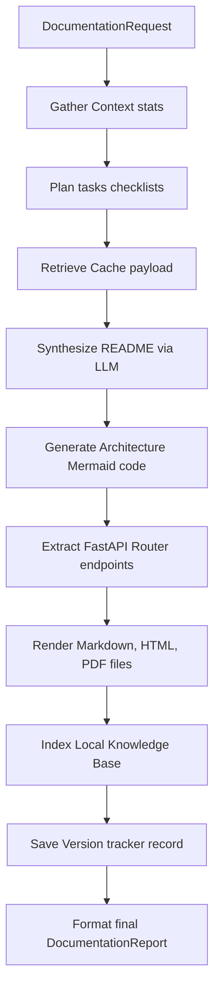

# SPEC M3.1.8 - Documentation & Knowledge Generation Engine Implementation Report

## Architecture & SOLID Compliance
The **Documentation & Knowledge Generation Engine** provides high-quality documentation capabilities:

1.  **Single Responsibility Principle (SRP)**:
    *   `planner.py`: Decomposes document task checklists.
    *   `context_builder.py`: Extracts workspace stats.
    *   `api_documenter.py`: Analyzes FastAPI endpoint structures.
    *   `diagram_generator.py`: Assembles visual Mermaid strings.
    *   `markdown_renderer.py` / `html_renderer.py` / `pdf_renderer.py`: Format layout renderers.
2.  **Open-Closed Principle (OCP)**:
    *   `interfaces.py` outlines base interfaces allowing the addition of custom templates formats or pdf renderer bindings without changing core orchestrator logic.
3.  **Liskov Substitution Principle (LSP)**:
    *   `FastAPIDocumenter` implements `APIDocumenter`. Alternative endpoints documenters can be swapped cleanly.
4.  **Interface Segregation Principle (ISP)**:
    *   Decoupled interfaces (`VersionTracker`, `TemplateEngine`, `Renderer`) ensure modules remain lightweight.
5.  **Dependency Inversion Principle (DIP)**:
    *   The `LocalDocumentationEngine` coordinates subcomponents by referencing abstract base interfaces.

---

## DDD Boundaries
*   **Bounded Context**: The Documentation and Knowledge Sub-Domain resides in the Software Engineering Bounded Context.
*   **Aggregate Root**: `DocumentationReport` aggregates synchronization results, compiled Markdown bodies, and generated target list files.
*   **Value Objects**: `DocumentationVersion`, `DocumentationChange`, and `KnowledgeEntry` represent immutable values.

---

## Documentation Generation Pipeline
The engine executes a clean multi-phase pipeline:

---

## Knowledge Architecture & Rendering Strategy
*   **Knowledge Index**: Indexes titles and terms descriptions into local maps cached inside `.nova/documentation/doc_cache.json`.
*   **Rendering**: Supports formatting to Markdown text, HTML wrapper templates, and PDF binary formats (via lightweight Python string layout wrappers).

---

## Performance Considerations
*   **Caching**: SHA-256 prompt matching avoids invoking local LLMs for identical requests.
*   **Workspace scans**: Filters ignore paths (such as `.git` and `.venv`) to minimize I/O overhead.
