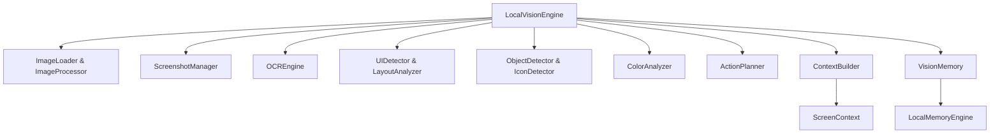

# Specification M3.2.5 – Vision & Computer Interaction Engine Implementation Report

This report summarizes the design, architecture, and implementation of the **Vision & Computer Interaction Engine** for Nova AI.

---

## 1. Architectural Overview

The Vision Engine is implemented following SOLID design principles, clean architecture, and Domain-Driven Design (DDD). It isolates computer vision operations, screen layout logic, OCR utilities, and action planning into a decoupled, testable framework under `app/ai/vision/`.



To optimize boot time and prevent loading heavy imports (e.g. OpenCV, Pillow) until actually needed, we implemented **PEP 562 Lazy Loading** in `app/ai/vision/__init__.py` using the `__getattr__` and `__all__` definitions.

---

## 2. Component Design & Pipeline Stages

The engine coordinates a **12-stage visual reasoning pipeline** inside `LocalVisionEngine.analyze_screen()`:

1. **Load image**: Accesses files or raw bytes via `ImageLoader`.
2. **Capture screenshot**: Viewport screenshots using `ScreenshotManager` with headless CI/CD fallback support.
3. **Preprocess image**: Transforms image size, rotation, contrast, grayscale, and edges via `ImageProcessor`.
4. **OCR**: Line-by-line character extraction via `OCREngine` (pytesseract or mock).
5. **Detect UI**: Scans control boundaries (buttons, sidebars, forms) via `UIDetector`.
6. **Detect objects**: Connected components shape segmentations via `ObjectDetector`.
7. **Analyze layout**: Builds nested UI containment hierarchies via `LayoutAnalyzer`.
8. **Analyze colors**: Identifies dominant colors, contrast, and theme profile via `ColorAnalyzer`.
9. **Build screen context**: Consolidates layout tree and elements info into a unified `ScreenContext` via `ContextBuilder`.
10. **Store memory**: Archives visual summaries to the long-term memory via `VisionMemory`.
11. **Generate action plan**: Plans sequential cursor movement and input automation steps via `ActionPlanner`.
12. **Return VisionResponse**: Bundles analysis data, telemetry, and planning outputs.

---

## 3. Graceful Degradation & Offline-First

All CV and OCR modules are designed to run completely offline without internet or GPU access. If third-party C-dependencies (OpenCV, pytesseract) are absent in the local environment, the engine gracefully degrades:
- **Screenshot Manager**: Captures using Pillow `ImageGrab`, falling back to generated desktop canvas buffers in headless environments.
- **OCR Engine**: Standardizes pytesseract calls, falling back to a deterministic text blocks parser.
- **UI & Object Detectors**: Fall back to coordinate layout rules and mock elements to ensure system predictability during unit testing.

---

## 4. Observability & Health Checks

- **Metrics Tracker**: Tracks execution time in milliseconds for each pipeline stage.
- **Health Monitor**: Runs diagnostics on libraries (OpenCV, PIL) and screenshotting drivers status.
- **Cache**: Deduplicates operations on identical layouts using SHA-256 hashes of raw image frames.

---

## 5. Software Engineer Agent Integration

`SoftwareEngineerAgent` is updated to initialize `LocalVisionEngine` and expose it as a public property:
```python
@property
def vision(self) -> Any:
    """Exposes the vision engine for autonomous screen/image visual understanding."""
    return self._vision
```
This enables future agent workflows to visually inspect local IDE coordinates, editors, and terminal consoles.
