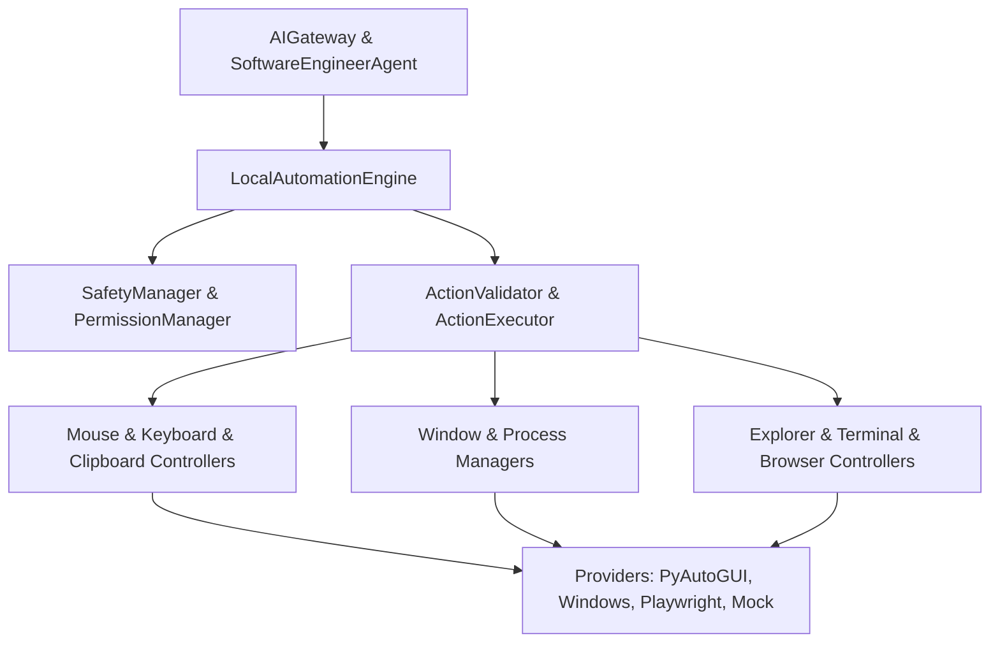

# Specification M3.2.6 – Desktop Automation & Computer Control Engine Implementation Report

This report summarizes the design, architecture, and verification of the **Desktop Automation & Computer Control Engine** implemented for Nova AI.

---

## 1. Architectural Design & Package Diagram

The desktop control subsystem is organized under `app/ai/automation/`. It abstracts raw inputs using domain-specific controllers and delegates commands to execution providers using strict permission filters and safety gatekeepers.



---

## 2. Core Execution Pipeline

All action sequence executions follow a robust 9-stage pipeline inside `LocalAutomationEngine.execute()`:

1. **Receive Request**: Validates `AutomationRequest` wrapping the target `ActionSequence`.
2. **Permission Check**: Verifies if the target domain fits active profiles (e.g. `ReadOnly` blocking mouse clicks).
3. **Safety Inspection**: Validates boundaries, coordinates, and filters banned terminal commands (e.g. `rm -rf`).
4. **Pre-State Logging**: Records preceding parameters (e.g., current clipboard value, active window focus) to allow restoration on failure.
5. **Coordinate Transform**: Converts relative Vision float coordinates (`0.0` - `1.0`) into absolute screen pixel dimensions.
6. **Provider Execution**: Dispatches execution events to active providers (e.g. hardware `pyautogui` inputs or offline `mock` actions).
7. **Rollback Recovery**: Instantly triggers the rollback plan (LIFO sequence) if any step fails.
8. **Memory RAG Archival**: Stores execution telemetry and timings summary using the memory engine.
9. **telemetry Response**: Bundles step results logs, safety violations, and performance metrics.

---

## 3. Safety, Permission, & Rollback Model

- **Safety Gatekeeper (`safety_manager.py`)**: Intercepts coord clicks falling into active restricted rectangular bounding boxes, and stops CLI sequences containing dangerous keywords.
- **Rollback Manager (`rollback_manager.py`)**: Implements automatic, LIFO recovery sequences. E.g. restoring text on clipboards, deleting created folders, and focusing back to previous active handles.
- **Permission manager (`permission_manager.py`)**: Restricts domains based on profiles:
  - `ReadOnly`: only permits searches, active window checks, and clipboard reading.
  - `BrowserOnly`: restricts actions to chromium navigation and clipboard reading.
  - `TerminalOnly`: restricts actions to console executions and clipboard reading.
  - `DesktopLimited`: allows desktop controls (clicking, typing) but prohibits terminal executions.
  - `DesktopFull` & `Administrator`: allows full access.

---

## 4. Providers Layer

- **PyAutoGUI Provider**: Enforces system-level coordinate clicking, scrolls, drags, and keystrokes.
- **Windows Provider**: Accesses local processes lists, active handles, window coordinates, and maximizes/minimizes handles via Win32 calls.
- **Playwright Provider**: Optional asynchronous chromium tab controller for DOM structures extraction, navigation, and inputs filling.
- **Mock Provider**: A deterministic offline provider that logs actions and mocks return buffers, facilitating test suite executions in headless CI/CD environments.

---

## 5. Verification Results

### Unit Tests Summary (`tests/test_automation_engine.py`)
Runs completely offline using mock providers.
- **11/11 tests passed** (including coordinate transformations, safety violations, permission profiles, clipboard history, macro recording, and rollbacks).
```text
tests\test_automation_engine.py ...........                              [100%]
======================= 11 passed, 3 warnings in 4.74s ========================
```

### Manual Validation Summary (`test_automation_manual.py`)
Programmatic checklist validating the execution lifecycle:
```text
=====================================================
Nova AI Desktop Automation Manual Validation
=====================================================
Stage 1  Configuration              PASS
Stage 2  Mouse Controller           PASS
Stage 3  Keyboard Controller        PASS
Stage 4  Clipboard                  PASS
Stage 5  Window Manager             PASS
Stage 6  Browser Controller         PASS
Stage 7  Terminal Controller        PASS
Stage 8  Rollback                   PASS
Stage 9  Safety                     PASS
Stage 10 Permission                 PASS
Stage 11 Vision Integration         PASS
Stage 12 Automation Pipeline        PASS

Stages passed : 12/12 (100%)
Desktop Automation Engine Healthy
```

---

## 6. Future Linux/macOS Compatibility
- **Windowing**: Can be extended to Linux/macOS using X11 `xdotool` bindings or Quartz window APIs respectively.
- **Launcher**: Standard shell binaries map dynamically depending on the host platform (e.g. `open` on macOS, `xdg-open` on Linux).
