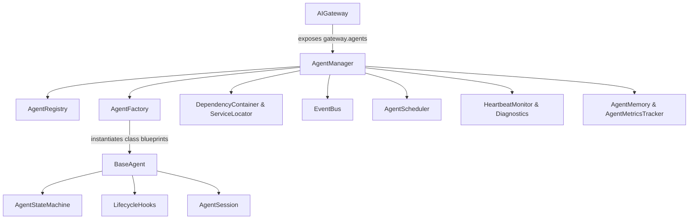
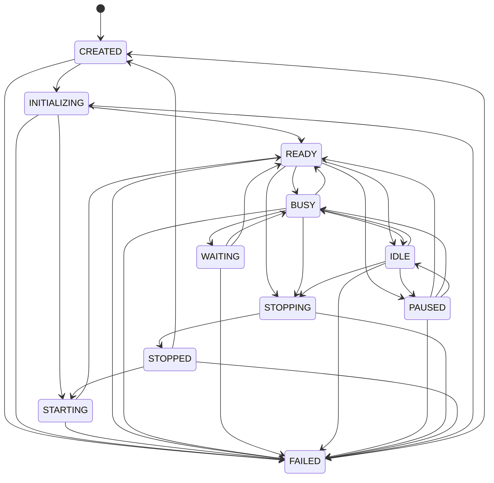

# Specification M3.3.1 – Multi-Agent Foundation Implementation Report

This report summarizes the design, architecture, and validation checks for the **Multi-Agent Foundation** framework implemented for Nova AI.

---

## 1. Architecture Overview & Package Diagram

The Multi-Agent Foundation provides the foundational runtime, lifecycle scheduler, registry, and dependency container for all current and future autonomous agents.



---

## 2. Agent Lifecycle & State Machine Transitions

Every agent inherits from `BaseAgent`, passing through 11 distinct runtime states governed by the `AgentStateMachine`:



---

## 3. Core Framework Components

- **Registry (`registry.py`)**: Stores class descriptors and metadata models. Supports lookups by ID and aliases.
- **Dependency Container (`dependency_container.py`)**: Lightweight IoC container managing singleton, transient, and scoped lifetimes. Used to inject AI Gateway, Memory, Vision, and Automation engines dynamically.
- **Event Bus (`event_bus.py`)**: Asynchronous Pub/Sub broker enabling agents to communicate via broadcasted event triggers (e.g. `AgentStarted`, `AgentFailed`).
- **Permissions System (`permissions.py`)**: Asserts security clearances hierarchically based on active profiles (`ReadOnly`, `Developer`, `Automation`, `Administrator`).
- **Heartbeat & Diagnostics (`heartbeat.py`, `diagnostics.py`)**: Periodically tracks running agents' memory usage, execution count, uptime, and records errors.
- **Memory Integration (`memory.py`)**: Indexes lifecycle and registration event summaries to the vector store (`LocalMemoryEngine`).

---

## 4. Verification Results

### Unit Tests Summary (`tests/test_agent_foundation.py`)
All 10 tests run completely offline and pass green:
```text
tests\test_agent_foundation.py ..........                                [100%]
====================== 10 passed, 13 warnings in 12.30s =======================
```

### Manual Validation Summary (`test_agent_foundation_manual.py`)
Validates registry entries, DI containers, schedulers, state machines, and health monitoring:
```text
===========================================
Nova AI Multi-Agent Foundation Validation
===========================================
Stage 1   Registry                  PASS
Stage 2   Manager                   PASS
Stage 3   Factory                   PASS
Stage 4   Lifecycle                 PASS
Stage 5   State Machine             PASS
Stage 6   Event Bus                 PASS
Stage 7   Dependency Injection      PASS
Stage 8   Scheduler                 PASS
Stage 9   Permissions               PASS
Stage 10  Heartbeat                 PASS
Stage 11  Memory                    PASS
Stage 12  Health                    PASS

Stages Passed: 12/12 (100%)

Multi-Agent Foundation Healthy
```
