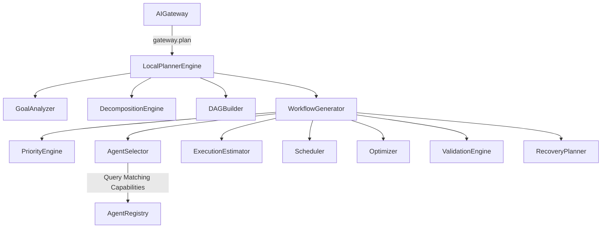

# Specification M3.3.2 – Intelligent Planner & Task Decomposition Engine Report

This report summarizes the design, architecture, and verification results for the **Intelligent Planner & Task Decomposition Engine** framework.

---

## 1. Architecture Overview & Package Diagram

The Intelligent Planner & Task Decomposition Engine translates a natural-language goal submitted by the user into a structured, validated, and optimized dependency DAG execution batches plan.



---

## 2. Planning Pipeline Flow (12 Stages)

1. **Goal Submission**: The planner receives a raw goal string and user request context metadata details.
2. **Cache Verification**: Checks the `PlannerCache` FIFO pool to find matching cached responses.
3. **Goal Analysis**: Classifies target domains (`enterprise_software`, `scientific_research`, `generic`), deliverables, and risk levels.
4. **Task Decomposition**: Recursively splits goals using structured template parameters.
5. **Task Tree Generation**: Compiles task hierarchies and DFS/BFS traversals.
6. **DAG Builder**: Translates trees into a directional graph (DAG).
7. **Priority Computation**: Traces the critical execution path.
8. **Agent Capability Matching**: Scans registry capabilities.
9. **Agent Selector**: Assigns tasks to specialist workers (or defaults to the `SoftwareEngineerAgent` default fallback).
10. **Resource Estimation**: Estimates timeouts, RAM, and token bounds.
11. **Parallel Scheduling**: Groups tasks topological lists into concurrent batches.
12. **degraded Recovery Map**: Compiles alternate agents lists.

---

## 3. Telemetry, Memory & Pub/Sub Events

- **Pub/Sub Integration**: Publishes lifecycle events (`PlanningStarted`, `GoalAnalyzed`, `TasksCreated`, `DAGGenerated`, `WorkflowCreated`, `PlanningCompleted`, `PlanningFailed`) via M3.3.1 `EventBus`.
- **RAG Memory Integration**: Saves formatted summary lines detailing session responses in the vector database via `LocalMemoryEngine`.
- **Telemetry & Uptime Probes**: Logs latency speeds metrics and registers sub-system states for active health checks.

---

## 4. Verification Results

### Unit Tests Summary (`tests/test_planner_engine.py`)
All 8 tests run completely offline and pass green:
```text
tests\test_planner_engine.py ........                                    [100%]
======================= 8 passed, 8 warnings in 22.24s ========================
```

### Manual Validation Summary (`test_planner_manual.py`)
Checks all 12 stages programmatically with zero external LLM dependencies:
```text
========================================
Nova AI Planner Validation
========================================
Stage 1 Goal Analysis PASS
Stage 2 Task Tree PASS
Stage 3 DAG PASS
Stage 4 Cycle Detection PASS
Stage 5 Optimization PASS
Stage 6 Scheduling PASS
Stage 7 Capability Matching PASS
Stage 8 Agent Selection PASS
Stage 9 Recovery PASS
Stage 10 Event Bus PASS
Stage 11 Memory PASS
Stage 12 Health PASS

Stages Passed
12 / 12

Planner Healthy
```
