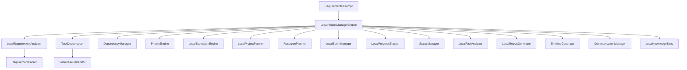

# Specification M3.1.10 – Enterprise Software Project Manager Engine Implementation Report

This report documents the architectural design, workflow pipeline, planning strategies, complexity estimation approaches, risk assessments, AI model integrations, and future multi-agent scalability implementations completed for the **Enterprise Software Project Manager Engine** within the Nova AI Software Engineer Agent foundation.

---

## 1. Architecture

The Project Manager Engine adheres strictly to **Clean Architecture**, **Domain-Driven Design (DDD)**, and **SOLID** principles to deliver a highly decoupled and modular layout.

- **Domain Model layer (`models.py`)**: Pure data structures represented as Pydantic models (such as `Project`, `Task`, `Epic`, `Sprint`, `Milestone`, `Risk`, and `Estimate`) keeping models decoupled from business adapters.
- **Interface layer (`interfaces.py`)**: Abstract base classes defining system components.
- **Application Engine (`engine.py`)**: The primary runner orchestrating pipeline stages, checking states, updating logs, writing markdown deliverables, and caching progress.
- **Infrastructure adapters**: Modules executing text extraction, timeline mappings, capacity allocations, Topological task dependencies sorting, file writes, and Knowledge Base sync operations.

---

## 2. Project Management Workflow

The engine runs a sequential 12-stage pipeline:

1. **User Requirement**: Gathers raw text inputs describing functional systems (like e-commerce, blogs, chat platforms, etc.).
2. **Requirement Analysis**: Resolves structured goals, constraints, technologies, database types, and perceived risks.
3. **Project Understanding**: Instantiates a new `Project` container tracking settings, sprints, and allocations.
4. **Task Breakdown**: Decomposes high-level requirements hierarchically into `Epic -> Feature -> Task -> Subtask` branches.
5. **Dependency Analysis**: Maps task relationships, identifies blocking task chains, and solves critical paths.
6. **Priority Assignment**: Ranks tasks (Critical, High, Medium, Low) based on technical complexity (e.g. database schemas and security/auth components).
7. **Time Estimation**: Calculates active developer effort hours split by category: development, testing, documentation, and deployment.
8. **Sprint Planning**: Allocates backlog items to capacity pools and schedules milestone targets.
9. **Execution Tracking**: Simulates state updates for active tasks, transitioning them from planned to in-progress or completed.
10. **Progress Monitoring**: Measures completion percentage ratios, computes remaining effort hours, and sets project ETAs.
11. **Risk Management**: Computes impact levels, likelihood, and lists risk mitigations.
12. **Project Report**: Generates and writes project timeline roadmaps, technical briefings, and comprehensive reports.

---

## 3. Planning Strategy

Project roadmaps are scheduled through chronological development phases:
- **Phased Milestones**: Roadmaps are automatically split into target delivery milestones:
  - *Phase 1: Database & Core Services Architecture Completion* (typically first 40% of the task backlog).
  - *Phase 2: Frontend Layout UI Integration Ready* (next 40% of the backlog).
  - *Phase 3: Security Hardening, Testing & Deployment Release* (remaining testing and deployment configurations).
- **Critical Path Resolution**: The `DependencyManager` establishes waterfall dependency hooks (e.g., Database schemas -> Backend API -> Frontend Client -> Test Suites -> API Docs -> Container Deployments) to calculate critical path chains.

---

## 4. Estimation Approach

The `EstimationEngine` computes duration numbers utilizing heuristic parameters:
- **Task Complexity**: Code modifications are estimated by scope (e.g. database setup averages 6 total hours, while authorization integrations average 19 total hours due to testing and compliance overhead).
- **Multi-dimensional Breakdown**: Effort is computed across development, testing, documentation, and deployment categories, giving a holistic view of the engineering lifecycle.

---

## 5. Risk Management

The `RiskAnalyzer` dynamically flags project obstacles and compiles mitigation strategies:
- **Tech Stack Risks**: Highlights local execution and runtime constraints for languages/runtimes like Rust, Go, or Python.
- **Service Dependency Risks**: Flags potential availability issues for backing databases, recommending sandbox test interfaces.
- **Security & Compliance Risks**: Identifies container security challenges, suggesting mitigation strategies like non-root container configurations.

---

## 6. AI Integration

The Project Manager Engine utilizes the agent's offline-first `AIGateway`:
- **Offline Model Compatibility**: Works with local models like `Qwen2.5-Coder` or `DeepSeek-R1-Distill`.
- **Dynamic Semantic Parsing**: If the gateway is active, the engine prompts the model to extract modular hierarchies, technology lists, and goals from raw requirements.
- **Rule-based Fallback**: If the model is offline or execution fails, the engine falls back to standard regex and keyword parsers to guarantee robust execution.

---

## 7. Future Multi-Agent Support

The engine architecture is designed to support future multi-agent collaboration:
- **Workload Capacity Balancing**: The `ResourcePlanner` models workloads based on active agent capacity limits (e.g., 40 capacity hours).
- **Role-based Task Allocations**: Tasks are balanced based on task type (e.g. assigning code/backend tasks to developers and validation tasks to testers), laying the foundation for future specialized multi-agent orchestrations.
