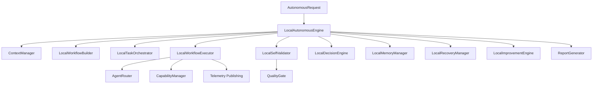

# Specification M3.1.11 – Autonomous Software Engineer Integration Engine Implementation Report

This report documents the architectural design, workflow pipeline, agent coordination strategies, decision reasoning engine, memory integrations, error recovery plans, quality validation gates, and future improvements implemented for the **Autonomous Software Engineer Integration Engine** of the Nova AI agent.

---

## 1. Architecture

The Autonomous Software Engineer Integration Engine serves as the final integration milestone of Phase 3, combining all previously developed specialized capability engines under a unified orchestrating pipeline.

- **Domain Model layer (`models.py`)**: Pure data structures represented as Pydantic models (such as `Workflow`, `WorkflowStep`, `TaskExecution`, `QualityReport`, `Decision`, `MemoryEntry`) decoupling pipeline execution parameters from runtime handlers.
- **Interface layer (`interfaces.py`)**: Abstract base classes defining system components.
- **Application Engine (`engine.py`)**: The primary runner orchestrating the 15-stage workflow pipeline, tracking state transitions, executing steps, updating files, and caching logs.
- **Infrastructure adapters**: Modules coordinating context analysis, topological sorting, routing requests, emitting event bus updates, evaluating quality gates, tracking failure recovery rollbacks, and syncing execution history with the Knowledge Base.

---

## 2. Autonomous Workflow Design

The engine executes a sequential 15-stage autonomous workflow pipeline:

1. **User Request**: Receives raw instructions describing development goals, bug fixes, refactoring requests, or deployment targets.
2. **Requirement Understanding**: Parsed to extract tech stack requirements, constraints, dependencies, modules, and goals.
3. **Project Planning**: Generates milestone phases, timelines, and schedules.
4. **Workspace Analysis**: Gathers git branch states and workspace directories listings.
5. **Solution Design**: Prepares developmental layout plans.
6. **Implementation Planning**: Automatically formats dependency sorting configurations.
7. **Code Generation**: Generates source code files, database schemas, and endpoints.
8. **Code Validation**: Performs syntax checks.
9. **Testing**: Generates and executes test suites.
10. **Debugging**: Resolves compilation and runtime test failures.
11. **Refactoring**: Cleans and lint-fixes file parameters.
12. **Documentation**: Documents project choices and README guides.
13. **Deployment Preparation**: Prepares container configurations and CI/CD pipelines.
14. **Final Review**: Runs Quality Gates checks.
15. **Response Generation**: Writes reports and updates cache parameters.

---

## 3. Agent Coordination & Routing

To guarantee correct execution mapping:
- **Capability Cataloging**: The `CapabilityManager` monitors active sub-engines, checking loaded capabilities, health state, and supported operations.
- **Engine Routing**: The `AgentRouter` reads step descriptions to dynamically select the correct sub-engine (e.g. mapping "unused symbols finder" to Code Intelligence Engine, "dockerize setup" to Deployment Engine, etc.).

---

## 4. Decision System

The system reasoning layer is controlled by the `DecisionEngine`:
- **Risk Assessment**: Proposed decisions are evaluated to flag risk constraints.
- **User Confirmations**: Actions classified as destructive (such as deleting files or database tables) automatically trigger confirmation prompts before execution.

---

## 5. Memory Strategy

Execution memory is managed by the `MemoryManager`:
- **Short-term Cache**: The cache preserves active pipeline states, timeline durations, and execution hashes in `.nova/autonomous_cache.json` for rollback reference.
- **Long-term Knowledge Sync**: Finished steps and architectural choices are archived as indexable knowledge entries inside the documentation Knowledge Base.

---

## 6. Recovery Strategy

To handle runtime task failures:
- **Monitored Execution**: Timings and execution outcomes are monitored.
- **Failure Recovery Actions**: The `RecoveryManager` calculates rollback pipelines, retries, alternative pathways (e.g., executing code repair on generation failures), or safe skips depending on failure types.

---

## 7. Quality Gates

Before generating final responses, the codebase is validated against 5 enterprise Quality Gates:
1. **Architecture Validation**: Verifies directory separators and boundaries layouts.
2. **Code Validation**: Performs clean syntax checks.
3. **Testing Validation**: Confirms test coverage files exist.
4. **Security Validation**: Reviews permission controls.
5. **Deployment Validation**: Verifies Dockerfile and docker-compose template structures.

---

## 8. Future Improvements

Future integrations include:
- **Specialized Multi-Agent Orchestration**: Dynamic task routing across multiple specialized AI agents.
- **LLM-Based Quality Checks**: Fine-tuned coding validators to dynamically evaluate security vulnerabilities in generated scripts.
- **Visual Telemetry Dashboards**: Web-based Gantt timeline dashboards consuming the event bus streams.
