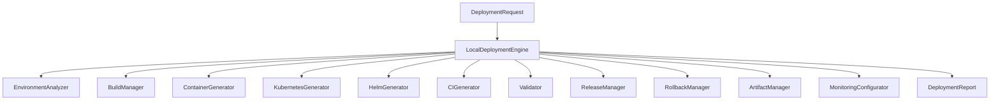

# Specification M3.1.9 – Enterprise Software Deployment Engine Implementation Report

This report documents the architectural patterns, security approach, container strategy, CI/CD configurations, rollback plans, AI integrations, and future cloud extension designs implemented for the **Enterprise Software Deployment Engine** within the Nova AI Software Engineer Agent foundation.

---

## 1. Architecture

The Enterprise Software Deployment Engine is designed using **Clean Architecture** and **Domain-Driven Design (DDD)** principles to ensure separation of concerns, high modularity, testability, and zero-cost, offline-first development. 

- **Domain Model layer (`models.py`)**: Defines pure data contracts (Pydantic models) such as `EnvironmentInfo`, `BuildResult`, `DockerConfiguration`, and `DeploymentReport` devoid of infrastructure-specific logic.
- **Interface layer (`interfaces.py`)**: Abstract definitions (`IEnvironmentAnalyzer`, `IBuildManager`, `IDeploymentEngine`, etc.) ensuring decoupling of components.
- **Application Engine (`engine.py`)**: Orchestrates the preparation lifecycle, utilizing individual specialized sub-components.
- **Infrastructure adapters**: Direct physical operations (reading dependencies, parsing environments, writing Dockerfiles / Compose / YAML workflows, tracking artifacts, compiling, and running local health specifications).

---

## 2. The 11-Stage Deployment Preparation Pipeline

The engine executes an autonomous pipeline sequentially to prepare a deployable artifact bundle:

1. **Project Analysis**: Gathers git branches, directories listing, and workspace details using the repository and intelligence engines.
2. **Environment Detection**: Detects programming languages (Python, Node.js, Java, Go, Rust), frameworks (FastAPI, React, Spring Boot, Gin, etc.), runtime versions, package managers, database backing engines, environment variables, and Docker files.
3. **Dependency Validation**: Scans package dependency manifests (like `requirements.txt`, `package.json`, `Cargo.toml`, `pom.xml`, etc.) checking for validity.
4. **Build Planning**: Assesses local files presence, directory structure, compile sanity, and test folders mapping to form a build execution strategy.
5. **Container Generation**: Generates standard production-ready, multi-stage `Dockerfile` and `docker-compose.yml` configs.
6. **Infrastructure Generation**: Prepares native Kubernetes manifests (Deployment, Service, ConfigMap, Secrets, Ingress, and Horizontal Pod Autoscaler) and complete Helm Chart hierarchies.
7. **CI/CD Generation**: Automatically designs pipeline definitions for GitHub Actions, GitLab CI, and Jenkinsfile pipelines.
8. **Deployment Validation**: Runs checks verifying YAML indentation compliance, required base-image directives, and secure user permissions.
9. **Release Preparation**: Auto-increments semantic patch versions, generates change notes, and catalogs release tags.
10. **Monitoring Setup**: Configures Prometheus alert rules and Grafana panels templates integrating with the agent's Observability SDK.
11. **Deployment Report**: Formats the final implementation summary markdown report.

---

## 3. Security Approach

The engine enforces enterprise security policies by design, ensuring no private data leakage:
- **Zero-plaintext Secrets**: The `SecretManager` creates templates recommending secure credential injection (e.g. 1Password CLI dynamic loading or environment variables) rather than writing secrets directly in config files.
- **Kubernetes Secret Templates**: Kubernetes manifest variables are isolated in `secrets.yaml` containing environment-mapped labels.
- **Image Scanning & Static Scans**: Generated GitHub Actions and GitLab CI configurations include explicit Security Scan stages (e.g. `gosec` or general scanners) configured with `continue-on-error` options.

---

## 4. Container Strategy

Containers are designed following industry best practices:
- **Multi-Stage Builds**: Distinct `builder` and `runner` phases. The builder compiles/installs dependencies, and the runner copies only the necessary runtimes, keeping final images lightweight.
- **Least Privilege Access**: Directives like `USER appuser` are configured so applications never run as `root`.
- **Active Health Checks**: Built-in `HEALTHCHECK` instructions check localhost loopbacks periodically.

---

## 5. CI/CD Design

Generated pipeline templates automate full verification:
1. **Checkout**: Pulls code securely.
2. **Dependency Install**: Installs packages using cached methods.
3. **Lint**: Validates standard style rules.
4. **Testing**: Runs unit and integration suites.
5. **Build**: Compiles binaries or assets.
6. **Security Scan**: Performs static code audits.
7. **Docker Build**: Packages target code.
8. **Deploy**: Triggers orchestration updates.

---

## 6. Rollback Strategy

To guarantee zero downtime and rapid failure recovery:
- **Deterministic rollbacks**: `RollbackManager` compiles a sequential rollback execution guide and generates a helper shell script to pull/run previous image hashes, update environment templates, execute database downgrades, and verify health.
- **Deployment Cache**: Tracks historical successful builds, metadata, and timestamps in `.nova/deployment_cache.json` for rollback reference.

---

## 7. AI Integration

The deployment engine leverages the agent's `AIGateway`:
- **Model Agnostic**: Compatible with offline, open-source models (such as `Qwen2.5-Coder`, `DeepSeek-Coder`, `StarCoder2`, etc.).
- **Dynamic Security Optimization**: If `AIGateway` is available, the engine prompts the model to optimize generated files for security. If offline/unavailable, it falls back to secure, deterministic template generation.

---

## 8. Future Cloud Extensions

The modular design allows easy extensions for cloud platforms:
- **Terraform / OpenTofu Generator**: Modules to generate cloud resources on AWS (ECS/EKS, RDS, VPC), Google Cloud (GKE, Cloud Run, Cloud SQL), or Azure (AKS).
- **Cloud Observability Adapters**: Adapters to send metrics directly to AWS CloudWatch, GCP Cloud Monitoring, or Datadog.
- **GitOps Integrations**: Custom generators targeting ArgoCD or FluxCD repository synchronization patterns.
