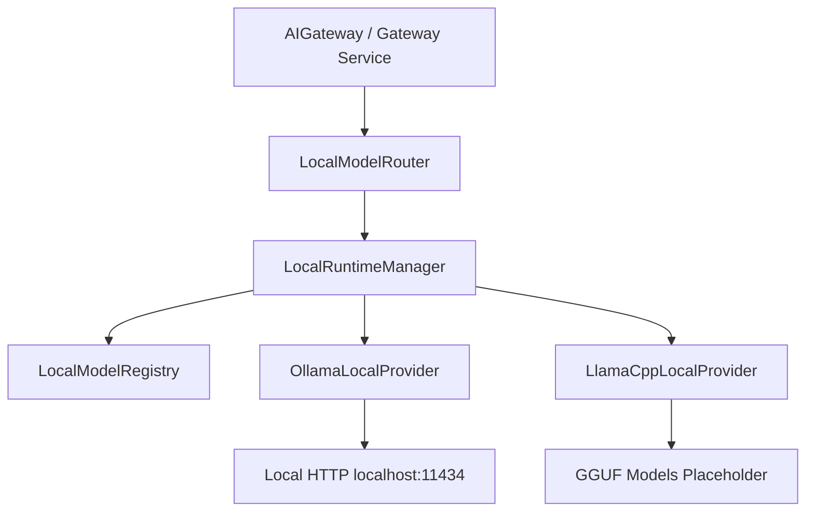

# Specification M3.2.1 – Enterprise Local AI Model Runtime Foundation Implementation Report

This report documents the architectural design, local AI execution strategies, zero-cost operational models, registered model scopes, runtime manager lifecycles, and future voice/vision capability integrations completed for the **Enterprise Local AI Model Runtime Foundation** of Nova AI.

---

## 1. Architecture

The Local Model Runtime implements a clean separation of concern boundaries, translating raw user prompts to local inference backends under the control of the central AI Gateway.

- **Domain Model layer (`models.py`)**: Defines `LocalModelInfo` schema representing model version tags, context boundaries, parameters count, and memory statuses. Defines `ModelCapability` capabilities enum.
- **Interface layer (`interfaces.py`)**: Abstract base classes defining system components.
- **Infrastructure adapters (`providers/`)**: Concrete runtime implementations interfacing local Ollama HTTP backends (`ollama.py` querying `http://localhost:11434`) and Llama.cpp setups (`llamacpp.py`).
- **Core Components**:
  - `configuration.py`: Validates quantization options, VRAM limits, and CPU fallbacks.
  - `registry.py`: Registers local model metadata records.
  - `runtime_manager.py`: Manages the lifecycle of local models.
  - `provider.py`: Implements the local routing router.
  - `health.py` / `metrics.py` / `cache.py` / `utils.py`: Manages health checks, telemetry collections, file caches, and hash keys.

---

## 2. Local AI Strategy & Zero-Cost Approach

To eliminate API invocation costs:
- **Offline-First execution**: The system functions completely offline, with no external network requests or SaaS API keys required.
- **Local Provider routing priority**: The AI Gateway was upgraded to check for local model availability. If a requested model is available and its provider (`ollama`) is active and healthy, the gateway routes the query locally.
- **Local Model Routing**: Pre-registered local models are dynamically selected based on task characteristics (e.g. coding requests route to `qwen2.5-coder`, reasoning requests route to `deepseek-r1-distill-qwen`, and embedding requests route to `nomic-embed-text`).

---

## 3. Supported Models

The local runtime registry pre-registers the following default open-source models:

| Model ID | Parameters | Target Workload | Capabilities | Context Window |
| --- | --- | --- | --- | --- |
| **`qwen2.5-coder`** | 7B | Coding and Refactoring | CHAT | 32,768 |
| **`deepseek-r1-distill-qwen`** | 8B | Multi-step reasoning | CHAT | 16,384 |
| **`nomic-embed-text`** | 137M | Local text embeddings | EMBEDDINGS | 8,192 |
| **`qwen2.5-vl`** | 7B | Multimodal vision tasks | VISION | 16,384 |

---

## 4. Runtime Design

- **Lazy loading**: To conserve GPU VRAM, models are only loaded into memory when required by a specific task.
- **VRAM Reclaiming**: Unused models can be dynamically unloaded. For Ollama, passing `keep_alive: 0` in `/api/chat` requests unloads the model from memory.
- **CPU Fallback**: If GPU VRAM allocation fails or is exceeded, the configuration supports graceful CPU-only execution fallbacks.

---

## 5. Future Compatibility

- **Voice Assistant Integration**: The `ModelCapability.AUDIO` enum is ready to register speech-to-text (Whisper) and text-to-speech local model pipelines.
- **Vision Assistant Integration**: Pre-registered `qwen2.5-vl` maps to `ModelCapability.VISION` to process multimodal image analyses locally.
- **RAG Memory Integration**: The `nomic-embed-text` embedding provider integrates with the local indexer to build offline knowledge indexes.
