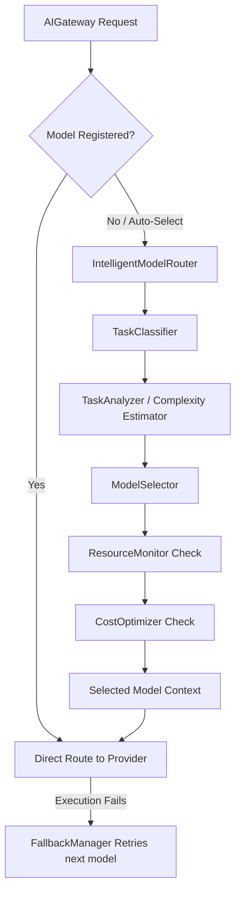

# Specification M3.2.2 – Intelligent AI Model Router Implementation Report

This report documents the architectural design, routing pipeline flow, model decision logic, fallback strategy, and performance metrics tracking completed for the **Intelligent AI Model Router** of Nova AI.

---

## 1. Architecture

The Intelligent Model Router is designed to orchestrate task routing decisions dynamically, checking hardware capacities, classifying prompts, and executing graceful fallback sequences.

- **TaskClassifier (`classifier.py`)**: Detects category types from prompt strings using keyword-based matching strategies.
- **TaskAnalyzer / Complexity Estimator (`task_analyzer.py`, `complexity_estimator.py`)**: Computes required capabilities, prompt length profiles, and complexity levels (Simple, Medium, Complex).
- **ModelSelector / RoutingStrategy (`model_selector.py`, `routing_strategy.py`)**: Selects optimal models (e.g. `qwen2.5-coder` for coding, `deepseek-r1-distill-qwen` for reasoning) and ranks models based on strategies (e.g., QUALITY_FIRST vs. LOW_MEMORY).
- **ResourceMonitor (`resource_monitor.py`)**: Asserts memory/RAM targets before loading large model params.
- **CostOptimizer (`cost_optimizer.py`)**: Enforces zero-cost local model priority, warning if cloud fallback is requested.
- **FallbackManager (`fallback_manager.py`)**: Manages retry attempts and selects alternative models.
- **RouterCache (`cache.py`)**: Stores routing decisions to disk under `.nova/cache/router/`.
- **RouterMetricsTracker (`metrics.py`)**: Interfaces with the Observability SDK to track latency, fallback, and routing decision volumes.

---

## 2. Dynamic Routing Flow

1. **Request Interception**: The `AIGateway` intercepts chat, stream_chat, and embedding generation requests. If a model name is not in the registry or is set to `"auto-select-me"`, the dynamic router is called.
2. **Heuristic Keyword Parsing**: The `TaskClassifier` maps incoming prompts to `TaskType` enums:
   - "debug", "error" -> `TaskType.DEBUGGING`
   - "refactor", "lint" -> `TaskType.REFACTORING`
   - "create", "write" -> `TaskType.CODE_GENERATION`
   - "plan", "architecture" -> `TaskType.PLANNING`
3. **Capabilities Mapping**: The `ModelSelector` resolves the primary target model and fallback sequence.
4. **VRAM check**: The `ResourceMonitor` checks memory footprints to ensure the local system has enough RAM (e.g., rejecting a model if RAM constraints are exceeded).
5. **Execution and Fallback**: If the model execution fails, the `FallbackManager` rotates models from the fallback chain.

---

## 3. Fallback and Recovery Logic

If a provider execution throws an exception, the router catches it, accesses the `FallbackManager`, rotates to the next model in the fallback chain (e.g. rotating from `qwen2.5-coder` to `deepseek-r1-distill-qwen`), updates the request model context, and retries the execution. If all fallbacks are exhausted, a `FallbackExhaustedError` is raised.

---

## 4. Performance & Telemetry Tracking

- **Latency Analysis**: Logs latency for both decision computations and provider executions.
- **Observability SDK Sync**: Decision outcomes are recorded through the `MetricsCollector` interface inside the Observability SDK.
- **Structured JSON Logging**: Fallbacks and decision outcomes are logged using `structlog`.
