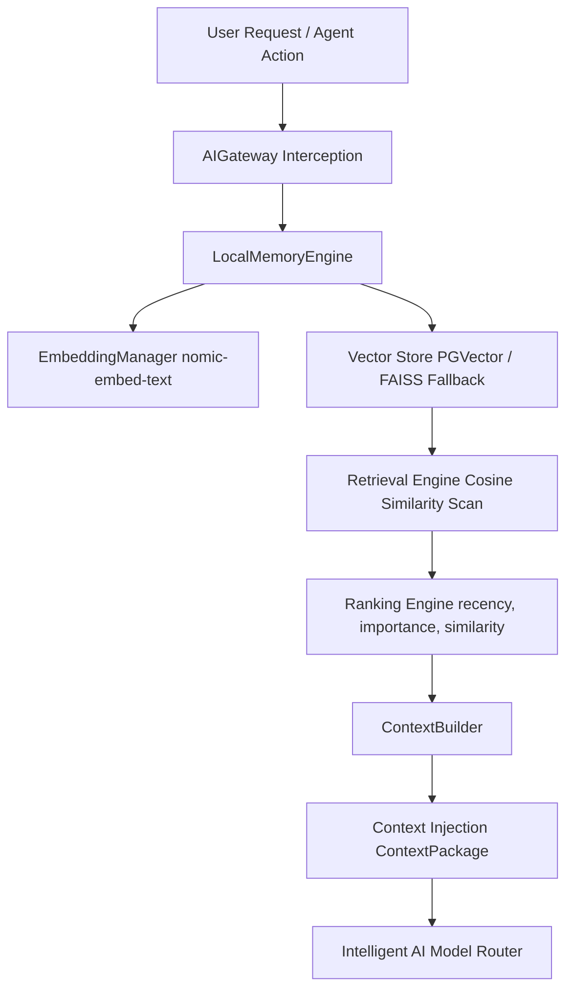

# Specification M3.2.3 – Enterprise Local RAG Memory System Implementation Report

This report documents the architectural design, RAG pipeline, vector database design, embedding strategy, retrieval flow, and performance metrics tracking completed for the **Enterprise Local RAG Memory System** of Nova AI.

---

## 1. Memory Architecture

The Local RAG Memory System implements a decoupled architecture that runs completely offline with zero SaaS dependencies or key requirements.

- **Domain Model layer (`models.py`)**: Defines enums and schemas (`MemoryType`, `MemoryItem`, `DocumentChunk`, `RetrievalResult`, `ContextPackage`).
- **Embedding Manager (`embedding_manager.py`)**: Interfaces with local Ollama embeddings endpoint, managing local caches and offline/test mock fallbacks.
- **Vector Storage Layer (`pgvector_store.py`, `faiss_store.py`)**:
  - `PGVectorStore`: Stores vectors and metadata using SQLAlchemy mappings.
  - `FAISSVectorStore`: Fallback local vector store serializer when PostgreSQL/pgvector is unavailable.

---

## 2. Document Processing & Chunking Pipeline

- **DocumentLoader & DocumentParser (`document_loader.py`, `document_parser.py`)**: Discovers project files and extracts textual content and metadata (filename, language, source path, tags).
- **DocumentChunker (`chunking_engine.py`)**: Chunks text utilizing size boundaries (default `500`) and overlap intervals (default `50`).
- **MemoryIndexer (`memory_indexer.py`)**: Indices parsing chunks and vectors into the vector stores database.

---

## 3. Retrieval and Ranking Flow

1. **Embedding Generation**: User queries are translated to vector embeddings.
2. **Similarity Filter**: Scans index using cosine similarity matching rules.
3. **Rank Selection**: The `RankingEngine` scores matches:
   `Final Score = Similarity * 0.6 + Importance * 0.2 + Recency * 0.2`
   - Recency decays exponentially based on age: `recency = 1.0 / (1.0 + diff_hours)`.
4. **Context Formatting**: The `ContextBuilder` aggregates results into system, conversation, project, and code segments, returning a structured `ContextPackage`.

---

## 4. Gateway and Agent Integration

- **AIGateway (`ai_gateway.py`)**: Intercepts chat and stream_chat operations to query memory context, inject ContextPackages, and asynchronously store conversation histories.
- **SoftwareEngineerAgent (`agent.py`)**: Instantiates `LocalMemoryEngine` as `self.memory` and exposes it via properties: `conversation_memory`, `project_memory`, and `code_memory`.
- **Database Schema (`memory_model.py`)**: Declares `MemoryModel` database entities mapped to table `memories`. Exposes both `Vector(768)` for pgvector environments and `ARRAY(Float)` fallbacks.
