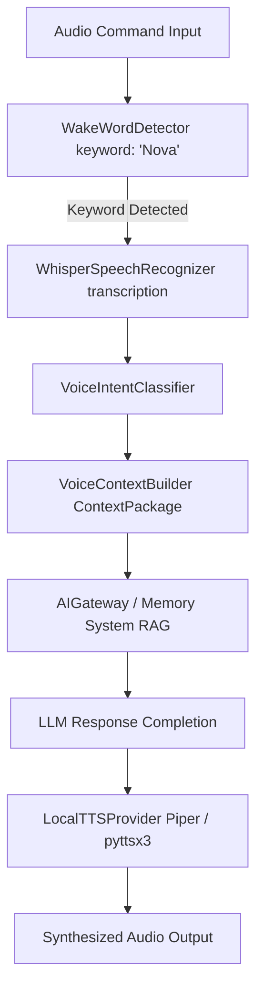

# Specification M3.2.4 – Enterprise Voice Intelligence Layer Implementation Report

This report documents the architectural design, providers, session pipelines, integration flows, and verification status completed for the **Enterprise Voice Intelligence Layer** of Nova AI.

---

## 1. Architecture

The Voice Intelligence Layer integrates audio streams, keyword triggers, transcription models, semantic intent categorizers, and TTS synthesizers.

- **Domain Model layer (`models.py`)**: Defines Pydantic models for request payloads and session registries (`VoiceRequest`, `VoiceResponse`, `SpeechResult`, `VoiceSession`, `VoiceCommand`).
- **Speech recognizer (`whisper_provider.py`)**: Interfaces local Whisper C++ compilations and fallback mock routines.
- **Text-To-Speech provider (`tts_provider.py`)**: Adapts local Piper TTS and pyttsx3 drivers to write wav audio responses, falling back to mock waves.
- **Wake Word Detector (`wake_word_detector.py`)**: Processes continuous listen events for keyword `"Nova"`.
- **Session Manager (`session_manager.py`)**: Tracks session statuses and timings.
- **Intent Classifier (`intent_classifier.py`)**: Heuristically resolves transcripts to intents:
  - "fix bug" -> debugging
  - "analyze code" -> code_intelligence
  - "remember" -> remember_this
- **Voice Context Builder (`context_builder.py`)**: Bundles active commands history.
- **LocalVoiceEngine orchestrator (`engine.py`)**: Traces execution loops connecting wake triggers to synthesized audio outputs.

---

## 2. Integrations

- **AIGateway (`ai_gateway.py`)**: Exposes support for `voice_context` parameters. Merges voice context (e.g. recent command lists) and RAG contexts before completion.
- **Memory System (`memory/engine.py`)**: Intercepts voice intents (like `"remember_this"`) to write content nodes to long-term memory.
- **SoftwareEngineerAgent (`agent.py`)**: Exposes properties `voice_engine` to trigger code intelligence and refactoring modules directly using voice command parameters.

---

## 3. Metrics & Caches

- **Metrics Tracker (`metrics.py`)**: Logs transcription and synthesis latencies to the Observability System.
- **Health diagnostics (`health.py`)**: Monitors provider connection statuses.
- **Audio caches (`cache.py`)**: Saves generated wave paths and text transcripts under `.nova/cache/voice/`.
