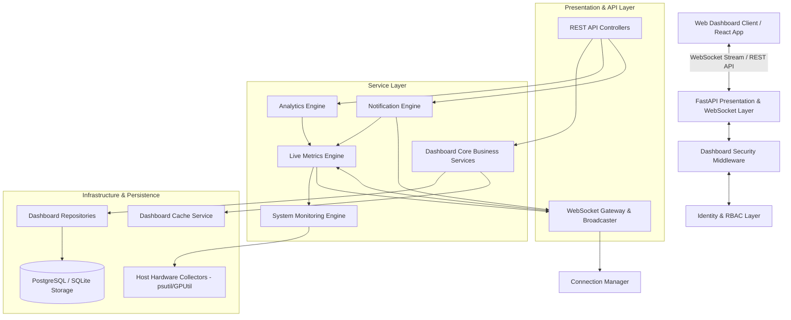
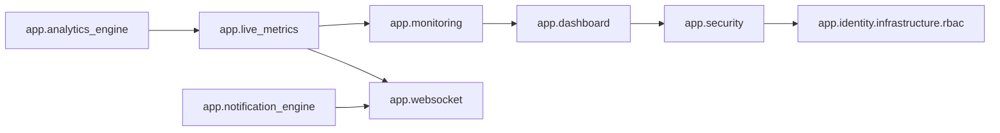

# Enterprise Dashboard System Architecture Guide

## Executive Overview
The **Nova AI Enterprise Dashboard Backend** is a production-grade, micro-modular, event-driven, high-performance telemetry platform engineered for real-time observability, predictive analytics, automated rule-based notification dispatching, and enterprise security control across the Nova AI Operating System.

---

## 1. High-Level Architecture & Layering

The system adopts a strictly decoupled, layered architecture:

---

## 2. Module Relationships & Dependency Graph

---

## 3. Core Engine Flow Architecture

### A. Telemetry Collection & Monitoring Flow
1. `SystemMonitoringEngine` schedules async polling routines across 7 sub-monitors (`CPUMonitor`, `MemoryMonitor`, `DiskMonitor`, `NetworkMonitor`, `GPUMonitor`, `ProcessMonitor`, `SystemMonitor`).
2. Hardware telemetry samples are sanitized, formatted into structured dictionaries, and cached in memory.

### B. Live Metrics & Delta Broadcast Flow
1. `LiveMetricsEngine` captures telemetry snapshots and passes them to `ChangeDetector`.
2. `ChangeDetector` compares current metrics against previous states using configured tolerance thresholds (`threshold=0.01`).
3. If changes exceed threshold bounds and pass `MetricsRateLimiter` sliding window filters, `MetricsPublisher` dispatches topic envelopes to `DashboardBroadcaster`.
4. `DashboardBroadcaster` delivers frames to subscribed clients managed by `ConnectionManager`.

### C. Rule Evaluation & Notification Flow
1. Telemetry changes trigger `NotificationRuleEngine` (16 default rules).
2. Priority levels (`LOW`, `NORMAL`, `HIGH`, `URGENT`) are assigned by `PriorityManager`.
3. Fingerprint hash deduplication is performed by `NotificationDeduplicator` over a 300s window.
4. Notifications are pushed into `NotificationQueue` (bounded max capacity 1,000).
5. `NotificationDispatcher` drains queue items, updates statistics, and broadcasts over the `notifications` WebSocket channel.

### D. Analytics & Trend Extrapolation Flow
1. `TimeSeriesEngine` buffers time-series points into hourly, daily, weekly, monthly, and yearly downsampled buckets.
2. `KPIEngine` calculates 12 real-time KPIs (CPU, RAM, GPU, Disk, Network, Latency, System Health, Notification Rate, Mission Completion %, Agent Availability %, Workflow %, Uptime).
3. `TrendAnalyzer` computes rolling averages and trend direction vectors (`Increasing`, `Stable`, `Decreasing`).
4. `AnomalyDetector` computes Z-scores against moving standard deviations to flag statistical spikes.
5. `InsightsEngine` synthesizes diagnostic recommendations.

### E. Security & Audit Logging Flow
1. `DashboardSecurityMiddleware` intercepts incoming HTTP requests, applying rate limiting, token verification, and security headers.
2. `ThreatDetector` analyzes failed login frequencies, payload sizes, and connection bursts.
3. Security anomalies trigger `SecurityMonitor` alerts and append structured events to `AuditLogger`.

---

## 4. Architectural Decision Records (ADRs)

1. **ADR-01: Decoupled Service Layer**: Routes must never access database repositories or SQLAlchemy ORM models directly. Services manage business logic and cache integration.
2. **ADR-02: Zero-Lock Circular Snapshots**: In-memory ring buffers with bounded capacities guarantee zero memory growth over time.
3. **ADR-03: Asynchronous Non-Blocking IO**: All collector polling operations run asynchronously or offload hardware calls via `asyncio.to_thread`.
4. **ADR-04: Channel-Based Subscriptions**: Clients subscribe exclusively to explicit topic channels (`dashboard`, `cpu`, `memory`, `system`, `notifications`).

---

## 5. Future Extensibility

- **Distributed Broker Integration**: ConnectionManager interface supports dropping in NATS / Redis PubSub backplanes for multi-node clustering.
- **Prometheus Metrics Exporter**: Telemetry metrics structures expose standard TSDB labels for Prometheus scraper integration.
