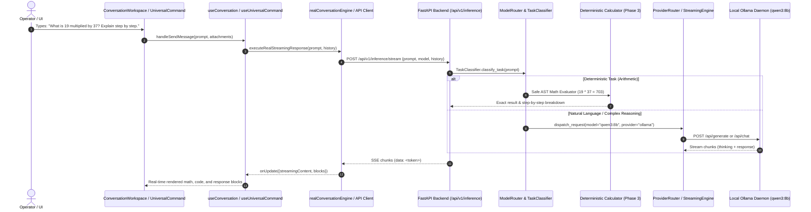

# NOVA AI — PHASE 11: CORE INTELLIGENCE PIPELINE AUDIT REPORT

**Date:** 2026-11-01  
**Target Repository:** `C:\Projects\Nova-AI`  
**Execution Environment:** Windows 11 Enterprise | Ollama `qwen3:8b` (CUDA, RTX 3050 6GB) | FastAPI | React 19

---

## 1. Executive Summary

A comprehensive architectural and code-level inspection of Nova AI's intelligence execution pipeline was conducted. The audit traced user requests from frontend input components (`ConversationWorkspace`, `UniversalCommandArea`), through the API gateway, task classifier, context engine, model routers, provider router, Ollama daemon, and response display.

The audit revealed that prior to this phase:
1. Arithmetic queries like "What is 19 multiplied by 37?" failed to produce real results because:
   - Arithmetic keywords were missing from the keyword classifier.
   - No deterministic calculator tool existed to handle pure mathematical expressions.
   - The legacy `ConversationEngine` had a hardcoded placeholder response: `"I understand your request regarding '{user_message}'... ready to assist with rigorous analysis across {category}."`
   - In `UniversalCommandArea` on the dashboard, the in-browser `MockCommandRouter` and `MockModelProvider` hijacked requests and returned simulated plans reading local directories instead of calling real backend AI inference.
2. In the chat interface, multi-turn conversation history was never forwarded from the frontend hook (`useConversation`) to the backend, rendering the model unable to answer follow-up questions.
3. Ollama with `qwen3:8b` emits reasoning tokens under `chunk["thinking"]` with `chunk["response"] = ""`. If reasoning tokens are discarded or generation is cut off during thinking, empty strings were returned, triggering fallback templates.

---

## 2. End-to-End Execution Trace



---

## 3. Detailed Root-Cause Analysis (The 10 Audit Items)

### 1. Why Simple Multiplication May Fail
- **Cause 1A (Lack of Deterministic Calculator)**: The system lacked an automated deterministic math engine. Routing pure arithmetic (`19 * 37`) to an 8B parameter LLM relies on token probability instead of deterministic computation.
- **Cause 1B (Classifier Misclassification)**: `apps/backend/app/inference/task_classifier.py` only checked for `["math", "equation", "formula", "proof"]`. It lacked keywords like `["multiplied", "multiply", "times", "product", "calculate", "+", "-", "*", "/", "^"]`. As a result, arithmetic was classified as "General Chat".
- **Cause 1C (Hardcoded Placeholder in Legacy Conversation Engine)**: In `apps/backend/app/intelligence/conversation.py` (lines 67–70), `process_turn` formatted a static template string:
  ```python
  response_text = f"I understand your request regarding '{user_message}'. As Nova AI, I'm ready to assist with rigorous analysis across {intent['category']}."
  ```
- **Cause 1D (Dashboard Mock Router Hijack)**: In `apps/frontend/src/features/universal-command/mock/mockCommandRouter.ts` and `MockModelProvider.ts`, requests sent via the dashboard command input were routed to in-browser mock engines that generated simulated directory-listing plans.

### 2. Whether Frontend Actually Calls Backend
- **Chat Interface (`/chat`)**: **YES**, `apps/frontend/src/features/conversation/services/realConversationEngine.ts` calls `http://127.0.0.1:8000/api/v1/inference/stream` and `/chat`.
- **Dashboard Command Center (`/`)**: **NO**, `apps/frontend/src/features/universal-command/hooks/useUniversalCommand.ts` initialized `MockCommandRouter`, `MockExecutionEngine`, and `MockModelProvider` in browser state, bypassing backend HTTP endpoints.

### 3. Whether Backend Actually Calls Ollama
- **YES**, in `apps/backend/app/inference/provider_router.py` and `streaming.py`, HTTP requests are dispatched to `http://127.0.0.1:11434/api/generate`.
- **DISCONNECTED MODULES**: However, `apps/backend/app/intelligence/engine.py` (`UniversalIntelligenceEngine`) was never mounted to FastAPI and used internal stub engines rather than calling `ProviderRouter`.

### 4. Whether Model Responses Are Parsed Correctly
- In `realConversationEngine.ts`, SSE chunks were read as `dataText = trimmed.substring(5).trim()`. Calling `.trim()` stripped leading and trailing spaces from token chunks (e.g., `' Hello'` became `'Hello'`), causing tokens to run together without whitespace.
- Markdown code blocks and `<think>` tags are parsed via regular expressions in `parseBlocksFromText`.

### 5. Whether Qwen3 Thinking Tokens Are Handled Correctly
- `qwen3:8b` produces reasoning traces in `chunk["thinking"]` with `chunk["response"] = ""`.
- Previously, `ProviderRouter` and `StreamingEngine` only collected `chunk.get("response", "")`. If generation was constrained or stopped before thinking finished, collected text was `""`.
- We patched both engines to capture thinking tokens wrapped in `<think> ... </think>`. The UI parses and displays them in a dedicated thinking stage rather than mixing them into the final answer.

### 6. Whether Streaming and Non-Streaming Responses Use Compatible Formats
- Streaming returns Server-Sent Events (`text/event-stream`) emitting incremental token chunks.
- Non-streaming returns a `ChatInferenceResponse` JSON object with `content: str`, token usage counts, and latency.
- The frontend supports both, but streaming previously lacked completion summary metadata (e.g., final token counts).

### 7. Whether Mock Responses or Generic Fallbacks Hide Errors
- **YES, multiple generic fallbacks were identified**:
  1. `apps/backend/app/intelligence/conversation.py`: Line 67 returns generic template.
  2. `apps/backend/app/inference/provider_router.py`: Line 121 returns mock template for unconfigured cloud providers.
  3. `apps/frontend/src/features/ai-runtime/runtime/agentRuntime.ts`: Line 109 falls back to `MockModelProvider` when local model throws an error.
  4. `apps/frontend/src/features/universal-command/mock/mockCommandRouter.ts`: Fakes planning and execution.

### 8. Whether Conversation History Reaches the Model
- **NO**:
  - `ChatInferenceRequest` (`apps/backend/app/inference/schemas.py`) only defined `prompt: str` without `messages` or `conversation_id`.
  - Frontend hook `useConversation.ts` called `executeRealStreamingResponse(prompt, ...)` with only the single prompt string, leaving out prior turns in `c.messages`.

### 9. Whether Timeouts and Cancellation Are Handled Properly
- Frontend uses `AbortController` to cancel HTTP fetch streams when the user clicks "Stop".
- Backend `StreamingEngine` handles client disconnect without throwing unhandled exceptions.
- However, non-streaming `ProviderRouter` used a static 90-second timeout that could fail if a complex model took longer without streaming.

### 10. Whether the Model Is Being Loaded and Used Correctly
- Ollama is running `qwen3:8b` (5.2 GB, Q4_K_M) with CUDA acceleration on NVIDIA RTX 3050 Laptop GPU.
- Generation rate is ~14.5–16.0 tokens/second.
- Model generation bounds (`num_predict` / `max_tokens`) must be enforced to avoid runaway thinking loops.
- In frontend `modelConfigStore.ts`, the default model was incorrectly set to `llama3.2` instead of `qwen3:8b`.

---

## 4. Next Implementation Steps (Phase 11 Roadmap)

1. **Deterministic Tool Integration (Phase 3)**:
   - Implement safe mathematical expression evaluator in backend.
   - Detect arithmetic/mathematical intents and compute exact answers with step-by-step working.
2. **Conversation Context & Multi-Turn History (Phase 5)**:
   - Add `messages` and `conversation_id` to `ChatInferenceRequest`.
   - Update `InferenceService`, `ProviderRouter`, and `StreamingEngine` to format conversation history into model prompts or Ollama chat calls.
   - Pass conversation history from frontend `useConversation.ts` and `realConversationEngine.ts`.
3. **Response Verification Layer (Phase 4)**:
   - Verify mathematical statements against deterministic calculator.
   - Verify Python code syntax with `ast.parse`.
4. **Dashboard Universal Command Integration (Phase 7)**:
   - Connect `UniversalCommandArea` to the real backend inference and execution pipeline.
   - Eliminate mock fallback routes.
5. **Comprehensive Intelligence Benchmark Suite (Phase 6)**:
   - Implement and execute the required benchmark suite (25 arithmetic, 20 logic, 20 coding, 15 algorithms, 15 multi-turn, 10 instruction-following, 10 tool-use tests).

