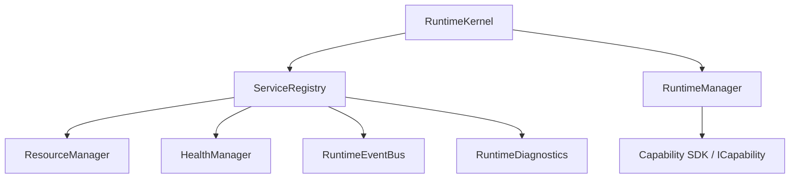
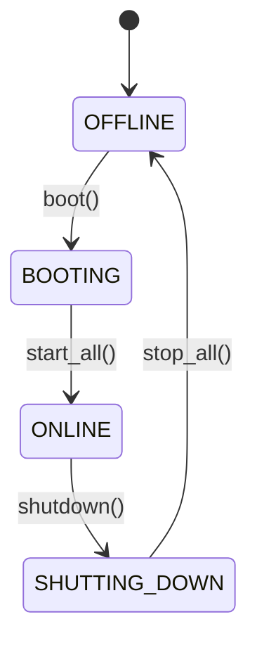
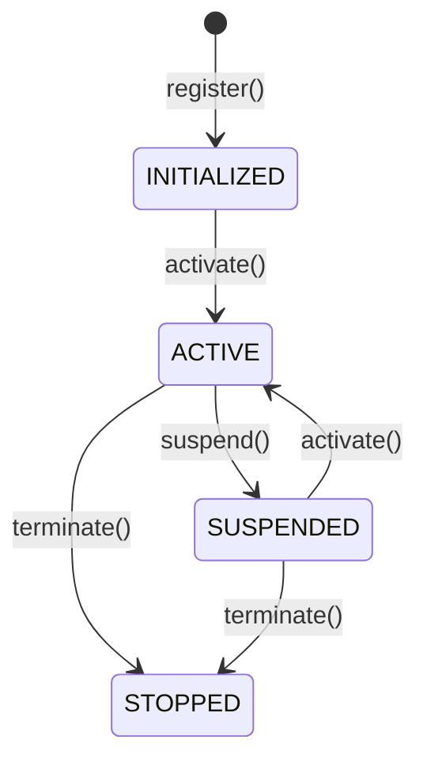

# Runtime Architecture - Nova AI Kernel & Capability SDK

This document describes the architectural layout, core components, domain-driven designs (DDD), and SOLID principles implementations for the **Nova AI Runtime Platform (Milestone M2)**.

---

## 1. System Component Architecture

The kernel runtime is designed as a self-contained ecosystem structured with a central orchestrator (`RuntimeKernel`) directing auxiliary subsystems registered under a `ServiceRegistry`:

### Component Details
1. **RuntimeKernel**: The central bootstrapper managing global execution configurations and orchestrating lifespan state changes.
2. **ServiceRegistry**: Coordinates execution starts/stops, resolving dependency hierarchies dynamically during system boot sequences.
3. **RuntimeEventBus**: Facilitates asynchronous, publish-subscribe decoupling between system actors. Maintains a structured history log for event replaying.
4. **ResourceManager**: Regulates processing limits (e.g. max memory, thread allocations) preventing service failures.
5. **HealthManager & Diagnostics**: Tracks consecutive heartbeat ticks and outputs aggregated snapshots of active subsystems.
6. **RuntimeManager & Capability SDK**: Hosts the developer extension kit. Supports hot-loading, activation, suspension, and safe termination of modular system capabilities.

---

## 2. SOLID Design Implementations

- **Single Responsibility (SRP)**: Each subsystem manages a single concern (e.g., `ResourceManager` only handles allocations; `HealthManager` only evaluates service liveness).
- **Open/Closed (OCP)**: New features and client extensions are loaded as modules implementing `ICapability` via the `RuntimeManager` without changing the kernel core.
- **Liskov Substitution (LSP)**: All system services implement `IKernelService` and can be registered and stopped by the registry uniformly without side effects.
- **Interface Segregation (ISP)**: Decoupled client capabilities (`ICapability`) from core service utilities (`IKernelService`), ensuring capability modules don't inherit unnecessary start/stop controls.
- **Dependency Inversion (DIP)**: Subsystems interact through abstraction boundaries (e.g. services refer to `IKernelService` rather than concrete classes).

---

## 3. Lifecycle State Diagrams

### Kernel States

### Capability Lifecycle States

